# Deep Dive: Interest Rate Modeling (Vasicek & HJM)

## High-Level Overview

---

## 🎯 The Big Picture: Why Model Interest Rates?

Interest rates are the **heartbeat of finance**. They affect:

- **Bond prices** — When rates go up, bond prices go down (and vice versa)
- **Loan costs** — Mortgages, corporate debt, everything
- **Derivatives pricing** — Swaps, options, futures
- **Insurance liabilities** — Present value of future claims
- **Pension funds** — Discounting future obligations

**The problem:** Interest rates are uncertain. We need to model how they might evolve to manage risk and price financial products.

---

## 📊 What is a Yield Curve?

Before diving into models, let's understand what we're modeling:

```
Interest Rate (%)
    │
  5%│                              ────────────
    │                    ─────────
  4%│              ──────
    │        ─────
  3%│   ────
    │───
  2%│
    └────────────────────────────────────────────► Time to Maturity
      1mo  6mo  1yr  2yr  5yr  10yr  20yr  30yr
```

The **yield curve** shows interest rates for different loan durations (maturities) at a single point in time.

**Key insight:** The yield curve changes every day. Sometimes it shifts up/down, sometimes it steepens/flattens, sometimes it twists.

---

## 🧩 The Two Modeling Philosophies

There are two fundamental approaches to model interest rates:

| Approach | Representative Model | Philosophy |
|----------|---------------------|------------|
| **Short-Rate Models** | Vasicek | Model the instantaneous (very short-term) rate, derive everything else |
| **Forward-Rate Models** | Heath-Jarrow-Morton (HJM) | Model the entire curve directly |

Think of it like weather forecasting:
- **Vasicek** = "Model today's temperature, assume it affects tomorrow"
- **HJM** = "Model the entire 10-day forecast as one system"

---

## 🔷 Vasicek Model — The Simple Starting Point

### Core Idea

The Vasicek model says: *Interest rates wander randomly, but they tend to be pulled back toward a long-term average* (like a rubber band).

### Intuition

Imagine interest rates as a dog on a leash:
- The dog (rate) wants to wander randomly
- The leash (mean reversion) pulls it back toward the owner (long-term average)
- Sometimes the dog strays far, but it always comes back

### The Dynamics (Simplified)

```
Rate tomorrow = Rate today 
                + Pull toward average 
                + Random shock
```

More precisely:
- If rates are **high** → they tend to go **down**
- If rates are **low** → they tend to go **up**
- But there's always **randomness** (market surprises)

### Key Parameters

| Parameter | Meaning | Intuition |
|-----------|---------|-----------|
| **θ** (theta) | Long-term average rate | Where rates "want" to be |
| **κ** (kappa) | Speed of mean reversion | How strong is the leash? |
| **σ** (sigma) | Volatility | How wild is the dog? |

---

## 🔶 Heath-Jarrow-Morton (HJM) — The Full Curve Approach

### Core Idea

Instead of modeling just one rate, HJM models the **entire forward rate curve** (all rates for all maturities) at once.

### What are Forward Rates?

A forward rate is the interest rate **agreed today** for a loan **starting in the future**.

Example: "The 1-year rate, 5 years from now" — this is a forward rate.

### The Challenge

The yield curve has infinitely many points (rates for every possible maturity). Modeling all of them is complex!

### The Solution: Factor Models

HJM recognizes that yield curve movements are **correlated**. When short rates move, long rates often move too (though not identically).

This is where **PCA (Principal Component Analysis)** comes in!

---

## 🎭 The Role of PCA

### The Problem

You have rates for many maturities (1mo, 3mo, 6mo, 1yr, 2yr, 5yr, 10yr, 30yr...). That's a lot of variables, and they're all correlated!

### The PCA Solution

PCA identifies the **main patterns** (factors) that explain most of the variation:

| Factor | Typical Interpretation | % Variance Explained |
|--------|------------------------|---------------------|
| **PC1** | Level (parallel shift) | ~80-90% |
| **PC2** | Slope (steepening/flattening) | ~5-10% |
| **PC3** | Curvature (butterfly) | ~2-3% |

### Visual Intuition

```
Factor 1: LEVEL (all rates move together)
    ↑↑↑↑↑↑↑↑↑↑↑↑ (curve shifts up/down)

Factor 2: SLOPE (short and long rates move opposite)
    ↑↑↑───────↓↓↓ (curve steepens/flattens)

Factor 3: CURVATURE (middle moves opposite to ends)
    ↓↓───↑↑↑───↓↓ (butterfly shape)
```

### Why This Matters

With just **3 factors**, you can explain **95%+** of yield curve movements! This makes HJM tractable:
- Instead of modeling 20+ rates
- You model just 3 factors
- Then reconstruct the full curve

---

## 🔗 How It All Connects

```
┌─────────────────────────────────────────────────────────────┐
│                    REAL MARKET DATA                         │
│              (Historical yield curves)                      │
└───────────────────────────┬─────────────────────────────────┘
                            │
                            ▼
┌─────────────────────────────────────────────────────────────┐
│                         PCA                                 │
│     Extract main factors (Level, Slope, Curvature)          │
└───────────────────────────┬─────────────────────────────────┘
                            │
              ┌─────────────┴─────────────┐
              ▼                           ▼
┌─────────────────────────┐   ┌─────────────────────────────┐
│     VASICEK MODEL       │   │         HJM MODEL           │
│  (Model the short rate) │   │  (Model factor dynamics)    │
│     Simple, 1 factor    │   │   Rich, multifactor         │
└─────────────────────────┘   └─────────────────────────────┘
              │                           │
              └─────────────┬─────────────┘
                            ▼
┌─────────────────────────────────────────────────────────────┐
│                    SIMULATED SCENARIOS                      │
│          (Future interest rate paths for risk)              │
└─────────────────────────────────────────────────────────────┘
```

---

## 🎓 Summary

| Concept | One-Liner |
|---------|-----------|
| **Yield Curve** | Snapshot of interest rates across all maturities |
| **Vasicek** | Simple model: rates randomly wander but revert to average |
| **HJM** | Advanced model: models entire forward curve dynamics |
| **PCA** | Reduces curve complexity to 3 interpretable factors |
| **Goal** | Simulate future rate scenarios for pricing and risk |

---

# Mathematical Formulation: Vasicek & HJM Models

## Detailed Mathematical Deep Dive

---

# Part 1: The Vasicek Model

## 1.1 The Stochastic Differential Equation (SDE)

The Vasicek model describes the evolution of the **instantaneous short rate** \( r(t) \) (the interest rate for an infinitesimally short period) through the following SDE:

\[
dr(t) = \kappa \left( \theta - r(t) \right) dt + \sigma \, dW(t)
\]

### Components Explained

| Symbol | Name | Description |
|--------|------|-------------|
| \( r(t) \) | Short rate | Instantaneous interest rate at time \( t \) |
| \( \kappa \) | Mean reversion speed | Rate at which \( r(t) \) is pulled toward \( \theta \) (units: 1/time) |
| \( \theta \) | Long-term mean | Equilibrium level of interest rates |
| \( \sigma \) | Volatility | Standard deviation of rate changes |
| \( W(t) \) | Wiener process | Standard Brownian motion (random walk) |
| \( dW(t) \) | Brownian increment | \( dW(t) \sim \mathcal{N}(0, dt) \) |

### Intuitive Breakdown

The SDE has two parts:

1. **Drift term:** \( \kappa(\theta - r(t)) \, dt \)
   - If \( r(t) > \theta \): drift is **negative** → rate pulled down
   - If \( r(t) < \theta \): drift is **positive** → rate pulled up
   - The parameter \( \kappa \) controls how fast this happens

2. **Diffusion term:** \( \sigma \, dW(t) \)
   - Random shocks to the rate
   - Scaled by volatility \( \sigma \)

---

## 1.2 Analytical Solution

The Vasicek SDE is linear, so it has a closed-form solution. Using the integrating factor method:

\[
r(t) = r(0) e^{-\kappa t} + \theta \left(1 - e^{-\kappa t}\right) + \sigma \int_0^t e^{-\kappa(t-s)} \, dW(s)
\]

### Distribution of \( r(t) \)

Since the stochastic integral is Gaussian, \( r(t) \) follows a **normal distribution**:

\[
r(t) \sim \mathcal{N}\left( \mu(t), \, v(t) \right)
\]

Where:

\[
\mu(t) = r(0) e^{-\kappa t} + \theta \left(1 - e^{-\kappa t}\right)
\]

\[
v(t) = \frac{\sigma^2}{2\kappa} \left(1 - e^{-2\kappa t}\right)
\]

### Long-Term Behavior

As \( t \to \infty \):

\[
r(t) \xrightarrow{d} \mathcal{N}\left( \theta, \, \frac{\sigma^2}{2\kappa} \right)
\]

The rate converges to a stationary distribution centered at \( \theta \) with variance \( \frac{\sigma^2}{2\kappa} \).

---

## 1.3 Zero-Coupon Bond Pricing

A **zero-coupon bond** pays \$1 at maturity \( T \). Its price at time \( t \) is:

\[
P(t, T) = \mathbb{E}^{\mathbb{Q}} \left[ e^{-\int_t^T r(s) \, ds} \, \Big| \, \mathcal{F}_t \right]
\]

Under the Vasicek model, this has an **explicit solution**:

\[
P(t, T) = A(t, T) \cdot e^{-B(t, T) \cdot r(t)}
\]

### The Functions \( A \) and \( B \)

\[
B(t, T) = \frac{1 - e^{-\kappa(T-t)}}{\kappa}
\]

\[
A(t, T) = \exp\left[ \left( \theta - \frac{\sigma^2}{2\kappa^2} \right) \left( B(t,T) - (T-t) \right) - \frac{\sigma^2}{4\kappa} B(t,T)^2 \right]
\]

### Key Insight

Bond prices are **exponentially affine** in \( r(t) \). This is why Vasicek is called an **affine term structure model**.

---

## 1.4 Yield Curve Derivation

The **continuously compounded yield** for maturity \( \tau = T - t \) is:

\[
y(t, \tau) = -\frac{\ln P(t, T)}{\tau} = -\frac{\ln A(t, T)}{\tau} + \frac{B(t, T)}{\tau} \cdot r(t)
\]

This can be written as:

\[
y(t, \tau) = y_\infty - \left( y_\infty - r(t) \right) \cdot \frac{1 - e^{-\kappa \tau}}{\kappa \tau} + \frac{\sigma^2}{4\kappa^3\tau} \left(1 - e^{-\kappa\tau}\right)^2
\]

Where the **asymptotic long rate** is:

\[
y_\infty = \theta - \frac{\sigma^2}{2\kappa^2}
\]

---

## 1.5 Simulation (Euler-Maruyama Discretization)

For numerical simulation, we discretize the SDE:

\[
r_{t+\Delta t} = r_t + \kappa(\theta - r_t) \Delta t + \sigma \sqrt{\Delta t} \cdot Z
\]

Where \( Z \sim \mathcal{N}(0, 1) \) is a standard normal random variable.

**Exact discretization** (since Vasicek is Gaussian):

\[
r_{t+\Delta t} = r_t e^{-\kappa \Delta t} + \theta(1 - e^{-\kappa \Delta t}) + \sigma \sqrt{\frac{1 - e^{-2\kappa \Delta t}}{2\kappa}} \cdot Z
\]

---

# Part 2: The Heath-Jarrow-Morton (HJM) Framework

## 2.1 Forward Rates

Instead of modeling the short rate, HJM models **instantaneous forward rates**.

**Definition:** The forward rate \( f(t, T) \) is the rate agreed at time \( t \) for an instantaneous loan at future time \( T \).

### Relationship to Zero-Coupon Bonds

\[
P(t, T) = \exp\left( -\int_t^T f(t, u) \, du \right)
\]

Or equivalently:

\[
f(t, T) = -\frac{\partial \ln P(t, T)}{\partial T}
\]

### Relationship to Short Rate

The short rate is the forward rate for immediate borrowing:

\[
r(t) = f(t, t)
\]

---

## 2.2 The HJM SDE

HJM models the evolution of the **entire forward curve** \( f(t, T) \) for all \( T \geq t \):

\[
df(t, T) = \alpha(t, T) \, dt + \sum_{i=1}^{n} \sigma_i(t, T) \, dW_i(t)
\]

### Components

| Symbol | Description |
|--------|-------------|
| \( f(t, T) \) | Forward rate at time \( t \) for maturity \( T \) |
| \( \alpha(t, T) \) | Drift of the forward rate |
| \( \sigma_i(t, T) \) | Volatility function for factor \( i \) |
| \( W_i(t) \) | Independent Brownian motions |
| \( n \) | Number of factors |

---

## 2.3 The HJM Drift Condition (No-Arbitrage)

The **key insight** of HJM: under the risk-neutral measure \( \mathbb{Q} \), the drift is **not free** — it's determined by the volatility structure!

\[
\alpha(t, T) = \sum_{i=1}^{n} \sigma_i(t, T) \int_t^T \sigma_i(t, u) \, du
\]

This can be written more compactly as:

\[
\alpha(t, T) = \sum_{i=1}^{n} \sigma_i(t, T) \cdot \Sigma_i(t, T)
\]

Where \( \Sigma_i(t, T) = \int_t^T \sigma_i(t, u) \, du \) is the **cumulative volatility**.

### Why This Matters

- You only need to specify the **volatility functions** \( \sigma_i(t, T) \)
- The drift follows automatically from no-arbitrage
- This is what makes HJM powerful: arbitrage-free by construction

---

## 2.4 From SDEs to the Full Dynamics

Substituting the drift condition:

\[
df(t, T) = \left( \sum_{i=1}^{n} \sigma_i(t, T) \int_t^T \sigma_i(t, u) \, du \right) dt + \sum_{i=1}^{n} \sigma_i(t, T) \, dW_i(t)
\]

### Evolution of the Short Rate

Since \( r(t) = f(t, t) \), we can derive:

\[
dr(t) = \left( \frac{\partial f}{\partial T}(t, t) + \alpha(t, t) \right) dt + \sum_{i=1}^{n} \sigma_i(t, t) \, dW_i(t)
\]

---

## 2.5 Common Volatility Specifications

### Constant Volatility (Ho-Lee)

\[
\sigma(t, T) = \sigma \quad \text{(constant)}
\]

This leads to the **Ho-Lee model**, where rates can go negative and don't mean-revert.

### Exponentially Decaying Volatility (Hull-White / Extended Vasicek)

\[
\sigma(t, T) = \sigma \cdot e^{-\kappa(T-t)}
\]

This gives mean-reverting dynamics similar to Vasicek, but fitted to the initial curve.

### General Multi-Factor Volatility

\[
\sigma_i(t, T) = \sigma_i \cdot e^{-\kappa_i(T-t)} \cdot g_i(t)
\]

Where \( g_i(t) \) can be time-varying volatility.

---

# Part 3: PCA in the HJM Framework

## 3.1 The Dimensionality Problem

In practice, we observe the yield curve at \( m \) discrete maturities: \( \tau_1, \tau_2, \ldots, \tau_m \).

Daily changes in yields form an \( m \)-dimensional vector:

\[
\Delta \mathbf{y}_t = \begin{pmatrix} \Delta y(t, \tau_1) \\ \Delta y(t, \tau_2) \\ \vdots \\ \Delta y(t, \tau_m) \end{pmatrix}
\]

**Problem:** These are highly correlated. We need to find the **underlying factors**.

---

## 3.2 PCA Decomposition

Let \( \mathbf{X} \) be the \( T \times m \) matrix of yield changes (T days, m maturities).

### Step 1: Covariance Matrix

\[
\mathbf{\Sigma} = \frac{1}{T-1} \mathbf{X}^\top \mathbf{X}
\]

### Step 2: Eigenvalue Decomposition

\[
\mathbf{\Sigma} = \mathbf{V} \mathbf{\Lambda} \mathbf{V}^\top
\]

Where:
- \( \mathbf{V} = [\mathbf{v}_1, \ldots, \mathbf{v}_m] \) — eigenvectors (principal components)
- \( \mathbf{\Lambda} = \text{diag}(\lambda_1, \ldots, \lambda_m) \) — eigenvalues (variance explained)

### Step 3: Interpretation

Each eigenvector \( \mathbf{v}_i \) represents a **factor loading** across maturities:

| PC | Typical Shape | Interpretation |
|----|---------------|----------------|
| \( \mathbf{v}_1 \) | Flat, all positive | **Level** — parallel shift |
| \( \mathbf{v}_2 \) | Monotonic slope | **Slope** — steepening/flattening |
| \( \mathbf{v}_3 \) | Hump or U-shape | **Curvature** — butterfly |

---

## 3.3 Linking PCA to HJM Volatility

The PCA factors directly inform the HJM volatility structure!

If we use \( n \) principal components, the volatility functions are:

\[
\sigma_i(t, T) = \sqrt{\lambda_i} \cdot v_i(T-t)
\]

Where \( v_i(\tau) \) is the \( i \)-th eigenvector value for maturity \( \tau \).

### The Factor Model Representation

Yield changes can be approximated as:

\[
\Delta y(t, \tau) \approx \sum_{i=1}^{n} v_i(\tau) \cdot F_i(t)
\]

Where \( F_i(t) \) are the **factor scores** (principal component values):

\[
F_i(t) = \sqrt{\lambda_i} \cdot Z_i(t), \quad Z_i \sim \mathcal{N}(0, 1)
\]

---

## 3.4 Mathematical Summary: PCA-HJM Connection

\[
\boxed{
df(t, T) = \left( \sum_{i=1}^{n} \sigma_i(T-t) \int_t^T \sigma_i(u-t) \, du \right) dt + \sum_{i=1}^{n} \sigma_i(T-t) \, dW_i(t)
}
\]

Where:

\[
\sigma_i(\tau) = \sqrt{\lambda_i} \cdot v_i(\tau)
\]

And \( v_i(\tau) \) comes from PCA on historical data!

---

# Part 4: Summary of Key Equations

## Vasicek Model

| Equation | Formula |
|----------|---------|
| **SDE** | \( dr = \kappa(\theta - r)dt + \sigma dW \) |
| **Solution** | \( r(t) \sim \mathcal{N}\left(\theta + (r_0 - \theta)e^{-\kappa t}, \frac{\sigma^2}{2\kappa}(1-e^{-2\kappa t})\right) \) |
| **Bond Price** | \( P(t,T) = A(t,T) e^{-B(t,T) r(t)} \) |
| **B Function** | \( B(t,T) = \frac{1-e^{-\kappa(T-t)}}{\kappa} \) |

## HJM Framework

| Equation | Formula |
|----------|---------|
| **Forward Rate SDE** | \( df(t,T) = \alpha(t,T)dt + \sum_i \sigma_i(t,T)dW_i \) |
| **Drift Condition** | \( \alpha(t,T) = \sum_i \sigma_i(t,T) \int_t^T \sigma_i(t,u)du \) |
| **PCA Volatility** | \( \sigma_i(\tau) = \sqrt{\lambda_i} \cdot v_i(\tau) \) |

---

# PCA Deep Dive: Principal Component Analysis for Yield Curves

## A Comprehensive Guide with Diagrams

---

# Part 1: What is PCA?

## 1.1 The Core Intuition

PCA answers the question: **"What are the main patterns driving this data?"**

Imagine you're watching a crowd of people move. Instead of tracking each person individually, PCA finds:
- Most people move **left-right** (main pattern)
- Some move **up-down** (secondary pattern)
- Few move **diagonally** (minor pattern)

For yield curves, instead of tracking 20+ rates, we find 3 main patterns that explain 95%+ of all movements.

---

## 1.2 PCA Workflow Overview

```mermaid
flowchart TB
    subgraph INPUT["📊 INPUT DATA"]
        A[Raw Yield Curve Data<br/>T days × m maturities]
    end
    
    subgraph PREP["🔧 PREPROCESSING"]
        B[Calculate Daily Changes<br/>ΔY = Yₜ - Yₜ₋₁]
        C[Center the Data<br/>Subtract mean from each column]
        D[Optional: Standardize<br/>Divide by std dev]
    end
    
    subgraph COMPUTE["⚙️ PCA COMPUTATION"]
        E[Compute Covariance Matrix<br/>Σ = X'X / (T-1)]
        F[Eigenvalue Decomposition<br/>Σ = VΛV']
        G[Sort by Eigenvalue<br/>λ₁ ≥ λ₂ ≥ ... ≥ λₘ]
    end
    
    subgraph OUTPUT["📈 OUTPUT"]
        H[Eigenvectors V<br/>= Factor Loadings]
        I[Eigenvalues Λ<br/>= Variance Explained]
        J[Principal Components<br/>= Factor Scores]
    end
    
    A --> B --> C --> D --> E --> F --> G
    G --> H
    G --> I
    G --> J
```

---

# Part 2: Mathematical Foundation

## 2.1 Setting Up the Data

### The Yield Curve Matrix

Let's say we have:
- **T** = number of trading days (e.g., 252 days = 1 year)
- **m** = number of maturities (e.g., 10 points: 1M, 3M, 6M, 1Y, 2Y, 3Y, 5Y, 7Y, 10Y, 30Y)

Our raw data matrix \( \mathbf{Y} \) is:

\[
\mathbf{Y} = \begin{pmatrix}
y_{1,1} & y_{1,2} & \cdots & y_{1,m} \\
y_{2,1} & y_{2,2} & \cdots & y_{2,m} \\
\vdots & \vdots & \ddots & \vdots \\
y_{T,1} & y_{T,2} & \cdots & y_{T,m}
\end{pmatrix}_{T \times m}
\]

Where \( y_{t,j} \) is the yield on day \( t \) for maturity \( j \).

---

## 2.2 Computing Yield Changes

We analyze **changes** (returns) rather than levels:

\[
\Delta y_{t,j} = y_{t,j} - y_{t-1,j}
\]

This gives us the change matrix:

\[
\mathbf{X} = \begin{pmatrix}
\Delta y_{2,1} & \Delta y_{2,2} & \cdots & \Delta y_{2,m} \\
\Delta y_{3,1} & \Delta y_{3,2} & \cdots & \Delta y_{3,m} \\
\vdots & \vdots & \ddots & \vdots \\
\Delta y_{T,1} & \Delta y_{T,2} & \cdots & \Delta y_{T,m}
\end{pmatrix}_{(T-1) \times m}
\]

### Why Changes?

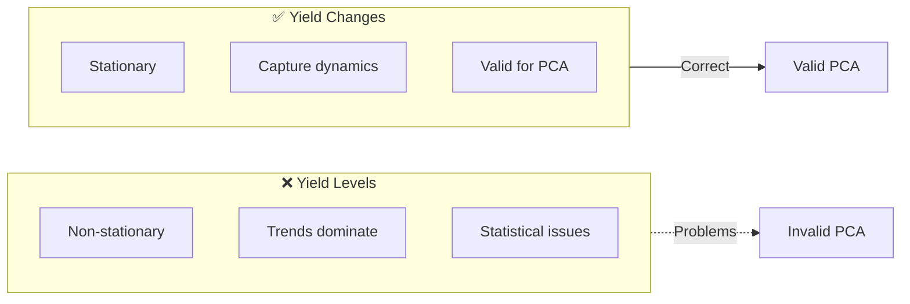

---

## 2.3 Centering the Data

Remove the mean from each column (maturity):

\[
\tilde{x}_{t,j} = \Delta y_{t,j} - \bar{\Delta y}_j
\]

Where:

\[
\bar{\Delta y}_j = \frac{1}{T-1} \sum_{t=2}^{T} \Delta y_{t,j}
\]

The centered matrix \( \tilde{\mathbf{X}} \) has **zero mean** in each column.

---

## 2.4 The Covariance Matrix

The sample covariance matrix is:

\[
\mathbf{\Sigma} = \frac{1}{T-2} \tilde{\mathbf{X}}^\top \tilde{\mathbf{X}}
\]

This is an \( m \times m \) symmetric matrix where:

\[
\Sigma_{ij} = \text{Cov}(\Delta y_{\cdot,i}, \Delta y_{\cdot,j})
\]

### Structure of the Covariance Matrix

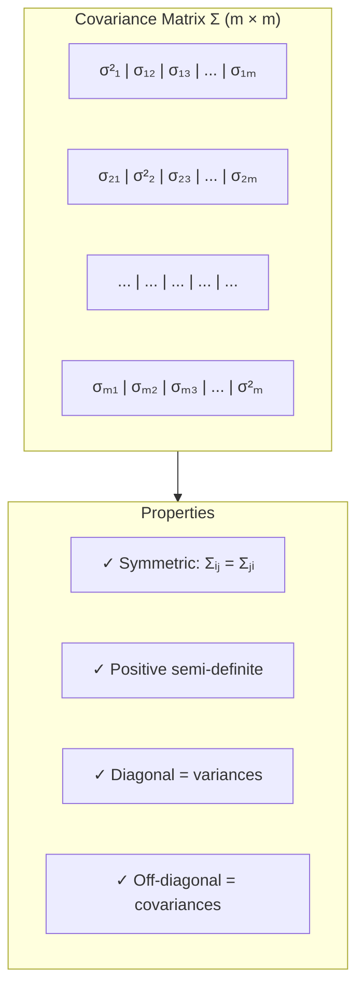

---

## 2.5 Eigenvalue Decomposition

We decompose the covariance matrix:

\[
\mathbf{\Sigma} = \mathbf{V} \mathbf{\Lambda} \mathbf{V}^\top
\]

Where:

\[
\mathbf{V} = \begin{pmatrix} | & | & & | \\ \mathbf{v}_1 & \mathbf{v}_2 & \cdots & \mathbf{v}_m \\ | & | & & | \end{pmatrix}_{m \times m}
\]

\[
\mathbf{\Lambda} = \begin{pmatrix} \lambda_1 & 0 & \cdots & 0 \\ 0 & \lambda_2 & \cdots & 0 \\ \vdots & \vdots & \ddots & \vdots \\ 0 & 0 & \cdots & \lambda_m \end{pmatrix}_{m \times m}
\]

### The Eigenvalue Equation

Each eigenvector-eigenvalue pair satisfies:

\[
\mathbf{\Sigma} \mathbf{v}_i = \lambda_i \mathbf{v}_i
\]

### Key Properties

| Property | Description |
|----------|-------------|
| \( \mathbf{v}_i^\top \mathbf{v}_j = \delta_{ij} \) | Eigenvectors are **orthonormal** |
| \( \lambda_i \geq 0 \) | Eigenvalues are **non-negative** |
| \( \sum_{i=1}^m \lambda_i = \text{tr}(\Sigma) \) | Total variance is **preserved** |
| \( \lambda_1 \geq \lambda_2 \geq \cdots \geq \lambda_m \) | Ordered by importance |

---

## 2.6 Variance Explained

Each eigenvalue represents the variance captured by its principal component:

\[
\text{Proportion of variance by PC}_i = \frac{\lambda_i}{\sum_{j=1}^m \lambda_j}
\]

\[
\text{Cumulative variance by first } k \text{ PCs} = \frac{\sum_{i=1}^k \lambda_i}{\sum_{j=1}^m \lambda_j}
\]

### Typical Results for Yield Curves

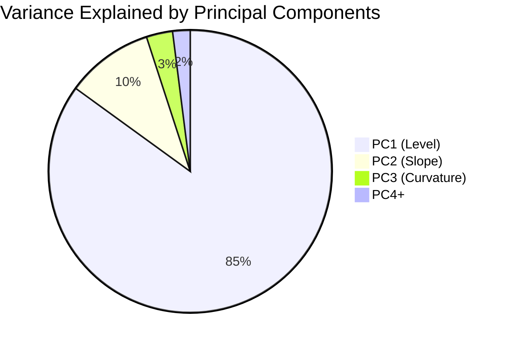

---

## 2.7 Principal Component Scores

The **factor scores** (principal components) are the projection of the data onto the eigenvectors:

\[
\mathbf{F} = \tilde{\mathbf{X}} \mathbf{V}
\]

Where \( \mathbf{F} \) is \( (T-1) \times m \) and:

\[
F_{t,i} = \sum_{j=1}^m \tilde{x}_{t,j} \cdot v_{i,j}
\]

This gives the value of each factor on each day.

---

# Part 3: Interpretation for Yield Curves

## 3.1 The Three Classical Factors

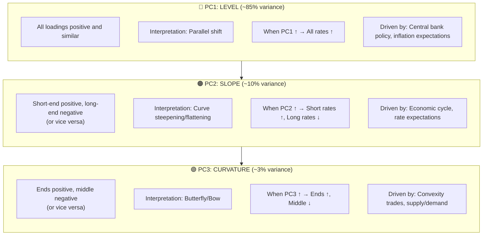

---

## 3.2 Visualizing Factor Loadings

Each eigenvector \( \mathbf{v}_i \) has \( m \) components—one for each maturity:

### PC1: Level Factor

```
Loading
   │
 1 │  ■───■───■───■───■───■───■───■───■───■
   │
 0 │─────────────────────────────────────────
   │
-1 │
   └──────────────────────────────────────────► Maturity
     1M   6M   1Y   2Y   3Y   5Y   7Y  10Y  30Y
```

**All loadings are positive and roughly equal** → All maturities move together.

### PC2: Slope Factor

```
Loading
   │
 1 │  ■───■
   │          ■
 0 │─────────────■───────────────────────────
   │                   ■───■
-1 │                          ■───■───■───■
   └──────────────────────────────────────────► Maturity
     1M   6M   1Y   2Y   3Y   5Y   7Y  10Y  30Y
```

**Short end positive, long end negative** → Slope changes (steepening/flattening).

### PC3: Curvature Factor

```
Loading
   │
 1 │  ■                               ■───■
   │      ■                       ■
 0 │─────────────────────────────────────────
   │            ■           ■
-1 │                ■───■
   └──────────────────────────────────────────► Maturity
     1M   6M   1Y   2Y   3Y   5Y   7Y  10Y  30Y
```

**Ends positive, middle negative** → Curvature changes (butterfly).

---

## 3.3 The Full PCA Pipeline

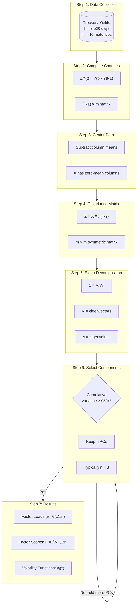

---

# Part 4: Determining the Number of Components

## 4.1 Methods for Choosing \( n \)

### Method 1: Cumulative Variance Threshold

Choose \( n \) such that:

\[
\frac{\sum_{i=1}^n \lambda_i}{\sum_{j=1}^m \lambda_j} \geq \text{threshold}
\]

Common thresholds: **90%, 95%, 99%**

### Method 2: Scree Plot

Plot eigenvalues and look for the "elbow":

```
Eigenvalue (log scale)
    │
100 │  ●
    │     ●
 10 │        ●
    │           ●────●────●────●────●────●────●
  1 │
    └─────────────────────────────────────────────► PC
       1    2    3    4    5    6    7    8    9   10
                   ↑
                 "Elbow"
```

### Method 3: Kaiser Criterion

Keep components with \( \lambda_i > \bar{\lambda} \) (above average eigenvalue).

### Method 4: Parallel Analysis

Compare eigenvalues to those from random data of the same size.

---

## 4.2 Decision Framework

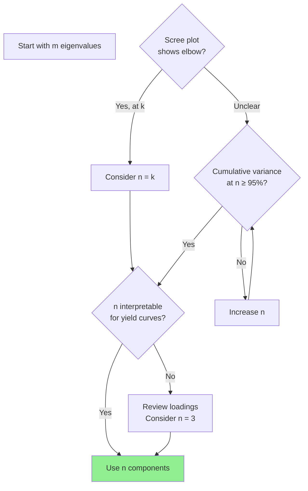

For yield curves, **n = 3** is almost always the right answer:
- PC1 = Level
- PC2 = Slope  
- PC3 = Curvature

---

# Part 5: Reconstruction and Error Analysis

## 5.1 Reconstructing Yield Changes

With \( n \) components, we approximate the original data:

\[
\Delta \hat{y}_{t,j} = \sum_{i=1}^n F_{t,i} \cdot v_{i,j} + \bar{\Delta y}_j
\]

Or in matrix form:

\[
\hat{\mathbf{X}} = \mathbf{F}_{(n)} \mathbf{V}_{(n)}^\top
\]

Where \( \mathbf{F}_{(n)} \) and \( \mathbf{V}_{(n)} \) are truncated to \( n \) components.

---

## 5.2 Reconstruction Error

The error from using only \( n \) components:

\[
\text{MSE} = \frac{1}{(T-1) \cdot m} \sum_{t,j} \left( \Delta y_{t,j} - \Delta \hat{y}_{t,j} \right)^2
\]

This equals:

\[
\text{MSE} = \frac{1}{m} \sum_{i=n+1}^m \lambda_i
\]

---

## 5.3 The Reconstruction Process

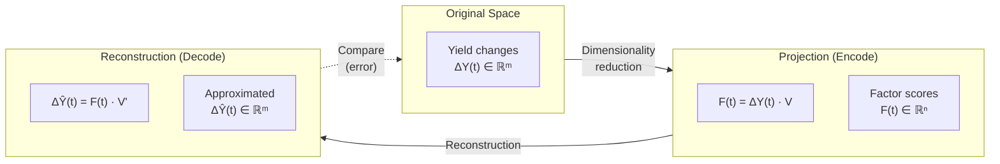

---

# Part 6: From PCA to HJM Volatility Functions

## 6.1 The Bridge

The PCA results directly give us the volatility functions for HJM:

\[
\sigma_i(\tau) = \sqrt{\lambda_i} \cdot v_i(\tau)
\]

Where:
- \( \lambda_i \) = \( i \)-th eigenvalue
- \( v_i(\tau) \) = \( i \)-th eigenvector loading for maturity \( \tau \)

---

## 6.2 Continuous Volatility Functions

In practice, we fit smooth functions to the discrete loadings:

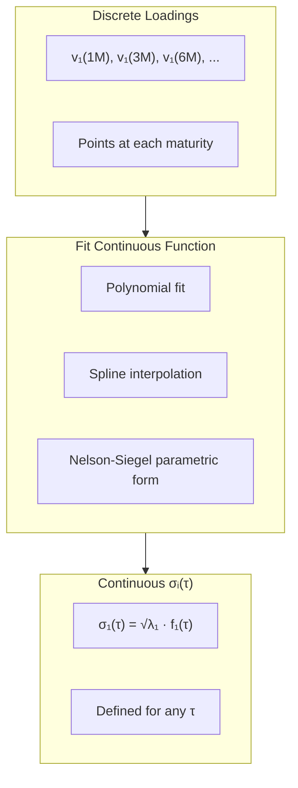

### Common Parametric Forms

**Exponential Decay (Hull-White style):**

\[
\sigma_1(\tau) = \sigma_1 \quad \text{(constant)}
\]

\[
\sigma_2(\tau) = \sigma_2 \cdot e^{-\kappa_2 \tau}
\]

\[
\sigma_3(\tau) = \sigma_3 \cdot \tau \cdot e^{-\kappa_3 \tau}
\]

---

## 6.3 The Complete HJM Specification

Once we have \( \sigma_i(\tau) \), the HJM dynamics are:

\[
df(t, T) = \left( \sum_{i=1}^{n} \sigma_i(T-t) \int_t^T \sigma_i(u-t) \, du \right) dt + \sum_{i=1}^{n} \sigma_i(T-t) \, dW_i(t)
\]

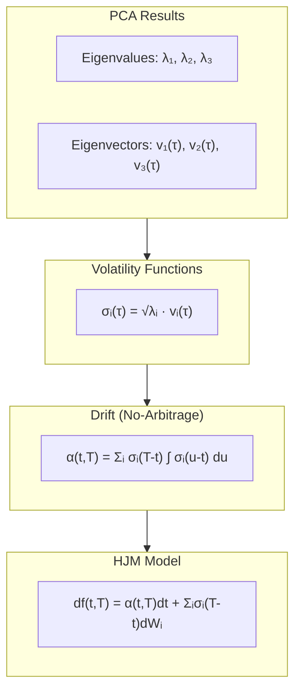

---

# Part 7: Summary

## 7.1 Key Formulas Reference

| Step | Formula |
|------|---------|
| **Yield Changes** | \( \Delta y_{t,j} = y_{t,j} - y_{t-1,j} \) |
| **Centering** | \( \tilde{x}_{t,j} = \Delta y_{t,j} - \bar{\Delta y}_j \) |
| **Covariance** | \( \Sigma = \tilde{X}^\top \tilde{X} / (T-2) \) |
| **Eigen Decomposition** | \( \Sigma = V \Lambda V^\top \) |
| **Variance Explained** | \( \lambda_i / \sum_j \lambda_j \) |
| **Factor Scores** | \( F = \tilde{X} V \) |
| **Reconstruction** | \( \hat{X} = F_{(n)} V_{(n)}^\top \) |
| **HJM Volatility** | \( \sigma_i(\tau) = \sqrt{\lambda_i} \cdot v_i(\tau) \) |

---

## 7.2 The Complete Pipeline

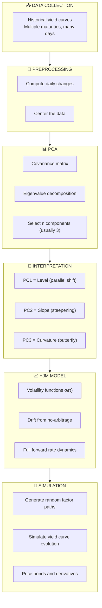

---

# Implementation Roadmap & Data Sources

## Complete Guide to Building the Vasicek-HJM Model

---

# Part 1: Project Structure

## 1.1 Recommended Directory Layout

```
interest-rate-models/
├── 📁 data/
│   ├── raw/                    # Raw downloaded data
│   ├── processed/              # Cleaned yield curves
│   └── results/                # Model outputs
│
├── 📁 src/
│   ├── __init__.py
│   ├── data_loader.py          # Data fetching & preprocessing
│   ├── pca_analysis.py         # PCA implementation
│   ├── vasicek_model.py        # Vasicek model
│   ├── hjm_model.py            # HJM framework
│   ├── simulation.py           # Monte Carlo simulation
│   ├── visualization.py        # Plotting utilities
│   └── utils.py                # Helper functions
│
├── 📁 notebooks/
│   ├── 01_data_exploration.ipynb
│   ├── 02_pca_analysis.ipynb
│   ├── 03_vasicek_calibration.ipynb
│   ├── 04_hjm_implementation.ipynb
│   └── 05_simulation_results.ipynb
│
├── 📁 tests/
│   ├── test_pca.py
│   ├── test_vasicek.py
│   └── test_hjm.py
│
├── requirements.txt
├── README.md
└── config.yaml                 # Configuration parameters
```

---

## 1.2 Dependencies

```
# requirements.txt
numpy>=1.24.0
pandas>=2.0.0
scipy>=1.10.0
scikit-learn>=1.2.0
matplotlib>=3.7.0
seaborn>=0.12.0
plotly>=5.14.0
yfinance>=0.2.0
fredapi>=0.5.0
requests>=2.28.0
pyyaml>=6.0
jupyter>=1.0.0
pytest>=7.0.0
```

---

## 1.3 Implementation Timeline

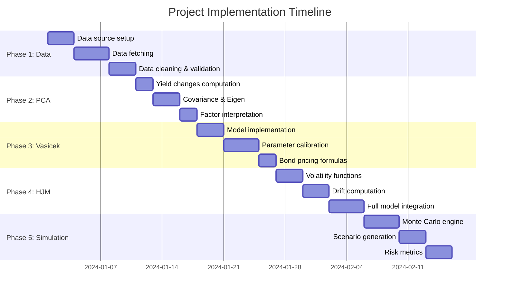

---

# Part 2: Data Sources

## 2.1 Overview of Available Sources

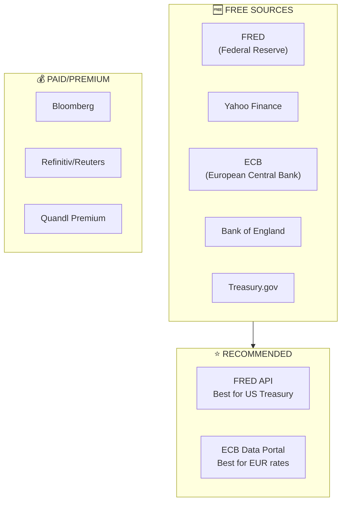

---

## 2.2 Source Comparison Table

| Source | Region | Data Quality | API | Cost | Ease of Use |
|--------|--------|--------------|-----|------|-------------|
| **FRED** | US | ⭐⭐⭐⭐⭐ | ✅ Python | Free | Easy |
| **Yahoo Finance** | US | ⭐⭐⭐ | ✅ yfinance | Free | Very Easy |
| **ECB** | Europe | ⭐⭐⭐⭐⭐ | ✅ REST | Free | Medium |
| **Bank of England** | UK | ⭐⭐⭐⭐ | ✅ REST | Free | Medium |
| **Treasury.gov** | US | ⭐⭐⭐⭐⭐ | ❌ CSV | Free | Manual |
| **Bloomberg** | Global | ⭐⭐⭐⭐⭐ | ✅ | $$$ | Complex |

---

## 2.3 FRED (Federal Reserve Economic Data) — Recommended

### Available Treasury Yield Series

| Maturity | FRED Series ID | Description |
|----------|----------------|-------------|
| 1 Month | `DGS1MO` | 1-Month Treasury Constant Maturity |
| 3 Month | `DGS3MO` | 3-Month Treasury Constant Maturity |
| 6 Month | `DGS6MO` | 6-Month Treasury Constant Maturity |
| 1 Year | `DGS1` | 1-Year Treasury Constant Maturity |
| 2 Year | `DGS2` | 2-Year Treasury Constant Maturity |
| 3 Year | `DGS3` | 3-Year Treasury Constant Maturity |
| 5 Year | `DGS5` | 5-Year Treasury Constant Maturity |
| 7 Year | `DGS7` | 7-Year Treasury Constant Maturity |
| 10 Year | `DGS10` | 10-Year Treasury Constant Maturity |
| 20 Year | `DGS20` | 20-Year Treasury Constant Maturity |
| 30 Year | `DGS30` | 30-Year Treasury Constant Maturity |

### Getting a FRED API Key

1. Go to: https://fred.stlouisfed.org/
2. Create a free account
3. Navigate to: My Account → API Keys
4. Request an API key (instant approval)

### Python Code: Fetching from FRED

```python
"""
data_loader.py - FRED Data Fetching Module
"""
import pandas as pd
import numpy as np
from fredapi import Fred
from typing import List, Optional
from datetime import datetime


class YieldCurveLoader:
    """
    Fetches and processes yield curve data from FRED.
    
    Attributes:
        fred: FRED API client instance.
        maturities: Dictionary mapping maturity labels to FRED series IDs.
    """
    
    # Mapping of maturities to FRED series IDs
    MATURITY_SERIES = {
        '1M': 'DGS1MO',
        '3M': 'DGS3MO',
        '6M': 'DGS6MO',
        '1Y': 'DGS1',
        '2Y': 'DGS2',
        '3Y': 'DGS3',
        '5Y': 'DGS5',
        '7Y': 'DGS7',
        '10Y': 'DGS10',
        '20Y': 'DGS20',
        '30Y': 'DGS30'
    }
    
    # Maturity in years for each label
    MATURITY_YEARS = {
        '1M': 1/12,
        '3M': 3/12,
        '6M': 6/12,
        '1Y': 1,
        '2Y': 2,
        '3Y': 3,
        '5Y': 5,
        '7Y': 7,
        '10Y': 10,
        '20Y': 20,
        '30Y': 30
    }
    
    def __init__(self, api_key: str):
        """
        Initialize the loader with FRED API key.
        
        Args:
            api_key: Your FRED API key.
        """
        self.fred = Fred(api_key=api_key)
    
    def fetch_yield_curve(
        self,
        start_date: str,
        end_date: Optional[str] = None,
        maturities: Optional[List[str]] = None
    ) -> pd.DataFrame:
        """
        Fetch historical yield curve data from FRED.
        
        Args:
            start_date: Start date in 'YYYY-MM-DD' format.
            end_date: End date in 'YYYY-MM-DD' format. Defaults to today.
            maturities: List of maturities to fetch. Defaults to all.
            
        Returns:
            DataFrame with dates as index and maturities as columns.
            Values are yields in percentage points.
        """
        if end_date is None:
            end_date = datetime.today().strftime('%Y-%m-%d')
        
        if maturities is None:
            maturities = list(self.MATURITY_SERIES.keys())
        
        # Fetch each series
        data = {}
        for maturity in maturities:
            series_id = self.MATURITY_SERIES[maturity]
            print(f"Fetching {maturity} ({series_id})...")
            
            series = self.fred.get_series(
                series_id,
                observation_start=start_date,
                observation_end=end_date
            )
            data[maturity] = series
        
        # Combine into DataFrame
        df = pd.DataFrame(data)
        df.index = pd.to_datetime(df.index)
        df.index.name = 'date'
        
        return df
    
    def clean_data(self, df: pd.DataFrame) -> pd.DataFrame:
        """
        Clean yield curve data: handle missing values and outliers.
        
        Args:
            df: Raw yield curve DataFrame.
            
        Returns:
            Cleaned DataFrame with no missing values.
        """
        # Forward fill missing values (carry forward last observation)
        df_clean = df.ffill()
        
        # Drop any remaining NaN rows (at the start)
        df_clean = df_clean.dropna()
        
        # Remove weekends (no trading)
        df_clean = df_clean[df_clean.index.dayofweek < 5]
        
        print(f"Cleaned data: {len(df_clean)} trading days")
        print(f"Date range: {df_clean.index[0]} to {df_clean.index[-1]}")
        
        return df_clean
    
    def compute_changes(self, df: pd.DataFrame) -> pd.DataFrame:
        """
        Compute daily yield changes.
        
        Args:
            df: Yield curve DataFrame.
            
        Returns:
            DataFrame of daily yield changes (in basis points).
        """
        # Daily differences (in percentage points)
        changes = df.diff().dropna()
        
        # Convert to basis points (1 bp = 0.01%)
        changes_bp = changes * 100
        
        return changes_bp
    
    def get_maturity_vector(self, maturities: List[str]) -> np.ndarray:
        """
        Get maturity values in years for the given labels.
        
        Args:
            maturities: List of maturity labels (e.g., ['1Y', '5Y', '10Y']).
            
        Returns:
            NumPy array of maturities in years.
        """
        return np.array([self.MATURITY_YEARS[m] for m in maturities])
```

---

## 2.4 Alternative: Yahoo Finance (Quick Start)

```python
"""
Alternative data source using Yahoo Finance.
Simpler but less comprehensive than FRED.
"""
import yfinance as yf
import pandas as pd


def fetch_treasury_yields_yahoo(
    start_date: str,
    end_date: str
) -> pd.DataFrame:
    """
    Fetch Treasury yields from Yahoo Finance.
    
    Note: Yahoo Finance has limited maturity coverage.
    
    Args:
        start_date: Start date 'YYYY-MM-DD'.
        end_date: End date 'YYYY-MM-DD'.
        
    Returns:
        DataFrame of Treasury yields.
    """
    # Yahoo Finance Treasury symbols
    symbols = {
        '5Y': '^FVX',   # 5-Year Treasury Yield
        '10Y': '^TNX',  # 10-Year Treasury Yield
        '30Y': '^TYX'   # 30-Year Treasury Yield
    }
    
    data = {}
    for maturity, symbol in symbols.items():
        ticker = yf.Ticker(symbol)
        hist = ticker.history(start=start_date, end=end_date)
        # Yahoo returns yield * 10 for some series
        data[maturity] = hist['Close'] / 10 if hist['Close'].mean() > 50 else hist['Close']
    
    df = pd.DataFrame(data)
    df.index = pd.to_datetime(df.index).tz_localize(None)
    
    return df
```

---

## 2.5 Alternative: ECB Data (European Rates)

```python
"""
Fetch Euro area yield curves from ECB Statistical Data Warehouse.
"""
import pandas as pd
import requests
from io import StringIO


def fetch_ecb_yield_curve(
    start_date: str,
    end_date: str
) -> pd.DataFrame:
    """
    Fetch Euro area AAA-rated government bond yields from ECB.
    
    Args:
        start_date: Start date 'YYYY-MM-DD'.
        end_date: End date 'YYYY-MM-DD'.
        
    Returns:
        DataFrame of Euro area yields.
    """
    # ECB Statistical Data Warehouse API
    base_url = "https://sdw-wsrest.ecb.europa.eu/service/data"
    
    # Euro area yield curve (AAA-rated)
    # Series keys for different maturities
    maturities = {
        '3M': 'YC.B.U2.EUR.4F.G_N_A.SV_C_YM.SR_3M',
        '1Y': 'YC.B.U2.EUR.4F.G_N_A.SV_C_YM.SR_1Y',
        '2Y': 'YC.B.U2.EUR.4F.G_N_A.SV_C_YM.SR_2Y',
        '5Y': 'YC.B.U2.EUR.4F.G_N_A.SV_C_YM.SR_5Y',
        '10Y': 'YC.B.U2.EUR.4F.G_N_A.SV_C_YM.SR_10Y',
        '30Y': 'YC.B.U2.EUR.4F.G_N_A.SV_C_YM.SR_30Y'
    }
    
    data = {}
    for maturity, series_key in maturities.items():
        url = f"{base_url}/{series_key}"
        params = {
            'startPeriod': start_date,
            'endPeriod': end_date,
            'format': 'csvdata'
        }
        
        response = requests.get(url, params=params)
        if response.status_code == 200:
            df_temp = pd.read_csv(StringIO(response.text))
            # ECB CSV format parsing
            data[maturity] = df_temp.set_index('TIME_PERIOD')['OBS_VALUE']
    
    df = pd.DataFrame(data)
    df.index = pd.to_datetime(df.index)
    
    return df
```

---

# Part 3: Implementation Roadmap

## Phase 1: Data Pipeline


### Code: Main Data Pipeline Script

```python
"""
main_data_pipeline.py - Execute the full data pipeline.
"""
import yaml
from src.data_loader import YieldCurveLoader


def main():
    """Run the complete data pipeline."""
    
    # Load configuration
    with open('config.yaml', 'r') as f:
        config = yaml.safe_load(f)
    
    # Initialize loader
    loader = YieldCurveLoader(api_key=config['fred_api_key'])
    
    # Fetch data (10 years of history)
    print("=" * 50)
    print("STEP 1: Fetching yield curve data from FRED")
    print("=" * 50)
    
    yields_raw = loader.fetch_yield_curve(
        start_date='2014-01-01',
        end_date='2024-01-01',
        maturities=['1M', '3M', '6M', '1Y', '2Y', '3Y', '5Y', '7Y', '10Y', '30Y']
    )
    
    # Clean data
    print("\n" + "=" * 50)
    print("STEP 2: Cleaning data")
    print("=" * 50)
    
    yields_clean = loader.clean_data(yields_raw)
    
    # Compute changes
    print("\n" + "=" * 50)
    print("STEP 3: Computing yield changes")
    print("=" * 50)
    
    yield_changes = loader.compute_changes(yields_clean)
    
    # Save results
    print("\n" + "=" * 50)
    print("STEP 4: Saving processed data")
    print("=" * 50)
    
    yields_clean.to_csv('data/processed/yield_curves.csv')
    yield_changes.to_csv('data/processed/yield_changes.csv')
    
    print(f"Saved {len(yields_clean)} days of yield curve data")
    print(f"Saved {len(yield_changes)} days of yield changes")
    
    # Summary statistics
    print("\n" + "=" * 50)
    print("DATA SUMMARY")
    print("=" * 50)
    print(f"\nYield Levels (%):")
    print(yields_clean.describe().round(2))
    print(f"\nYield Changes (bp):")
    print(yield_changes.describe().round(2))


if __name__ == "__main__":
    main()
```

---

## Phase 2: PCA Analysis

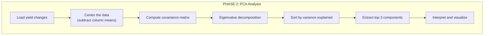

### Code: PCA Implementation

```python
"""
pca_analysis.py - Principal Component Analysis for yield curves.
"""
import numpy as np
import pandas as pd
from typing import Tuple, Dict
from dataclasses import dataclass


@dataclass
class PCAResult:
    """Container for PCA results."""
    eigenvalues: np.ndarray
    eigenvectors: np.ndarray
    variance_explained: np.ndarray
    cumulative_variance: np.ndarray
    factor_scores: np.ndarray
    maturities: list
    n_components: int


class YieldCurvePCA:
    """
    PCA analysis for yield curve movements.
    
    Extracts principal components (Level, Slope, Curvature) from
    historical yield curve changes.
    """
    
    def __init__(self, n_components: int = 3):
        """
        Initialize PCA analyzer.
        
        Args:
            n_components: Number of principal components to retain.
        """
        self.n_components = n_components
        self.result: PCAResult = None
        self._mean = None
        self._std = None
    
    def fit(
        self, 
        yield_changes: pd.DataFrame,
        standardize: bool = False
    ) -> PCAResult:
        """
        Fit PCA to yield curve changes.
        
        Args:
            yield_changes: DataFrame of daily yield changes.
                           Rows = dates, Columns = maturities.
            standardize: If True, standardize (z-score) before PCA.
            
        Returns:
            PCAResult containing all PCA outputs.
        """
        # Convert to numpy
        X = yield_changes.values
        maturities = list(yield_changes.columns)
        
        # Step 1: Center the data
        self._mean = X.mean(axis=0)
        X_centered = X - self._mean
        
        # Optional: Standardize
        if standardize:
            self._std = X.std(axis=0)
            X_centered = X_centered / self._std
        
        # Step 2: Compute covariance matrix
        n_samples = X_centered.shape[0]
        cov_matrix = (X_centered.T @ X_centered) / (n_samples - 1)
        
        # Step 3: Eigenvalue decomposition
        eigenvalues, eigenvectors = np.linalg.eigh(cov_matrix)
        
        # Step 4: Sort by eigenvalue (descending)
        idx = np.argsort(eigenvalues)[::-1]
        eigenvalues = eigenvalues[idx]
        eigenvectors = eigenvectors[:, idx]
        
        # Step 5: Compute variance explained
        total_variance = eigenvalues.sum()
        variance_explained = eigenvalues / total_variance
        cumulative_variance = np.cumsum(variance_explained)
        
        # Step 6: Compute factor scores (projection onto PCs)
        factor_scores = X_centered @ eigenvectors[:, :self.n_components]
        
        # Store results
        self.result = PCAResult(
            eigenvalues=eigenvalues,
            eigenvectors=eigenvectors,
            variance_explained=variance_explained,
            cumulative_variance=cumulative_variance,
            factor_scores=factor_scores,
            maturities=maturities,
            n_components=self.n_components
        )
        
        return self.result
    
    def get_loadings(self) -> pd.DataFrame:
        """
        Get factor loadings as a DataFrame.
        
        Returns:
            DataFrame with maturities as index and PCs as columns.
        """
        if self.result is None:
            raise ValueError("Must call fit() first")
        
        loadings = pd.DataFrame(
            self.result.eigenvectors[:, :self.n_components],
            index=self.result.maturities,
            columns=[f'PC{i+1}' for i in range(self.n_components)]
        )
        return loadings
    
    def get_volatility_functions(self, maturity_years: np.ndarray) -> Dict[str, np.ndarray]:
        """
        Get HJM volatility functions from PCA.
        
        Args:
            maturity_years: Array of maturities in years.
            
        Returns:
            Dictionary with volatility function for each PC.
        """
        if self.result is None:
            raise ValueError("Must call fit() first")
        
        volatilities = {}
        for i in range(self.n_components):
            # σ_i(τ) = sqrt(λ_i) * v_i(τ)
            sigma_i = np.sqrt(self.result.eigenvalues[i]) * self.result.eigenvectors[:, i]
            volatilities[f'sigma_{i+1}'] = sigma_i
        
        return volatilities
    
    def reconstruct(self, n_components: int = None) -> np.ndarray:
        """
        Reconstruct yield changes using n components.
        
        Args:
            n_components: Number of components to use. Defaults to self.n_components.
            
        Returns:
            Reconstructed yield changes.
        """
        if self.result is None:
            raise ValueError("Must call fit() first")
        
        if n_components is None:
            n_components = self.n_components
        
        # Reconstruction: X_hat = F * V'
        reconstructed = (
            self.result.factor_scores[:, :n_components] @ 
            self.result.eigenvectors[:, :n_components].T
        )
        
        # Add back the mean
        reconstructed += self._mean
        
        return reconstructed
    
    def summary(self) -> str:
        """Generate a text summary of PCA results."""
        if self.result is None:
            raise ValueError("Must call fit() first")
        
        lines = [
            "=" * 60,
            "PCA RESULTS SUMMARY",
            "=" * 60,
            "",
            "Variance Explained by Component:",
            "-" * 40
        ]
        
        for i in range(min(5, len(self.result.eigenvalues))):
            lines.append(
                f"  PC{i+1}: {self.result.variance_explained[i]*100:6.2f}% "
                f"(cumulative: {self.result.cumulative_variance[i]*100:6.2f}%)"
            )
        
        lines.extend([
            "",
            f"Components retained: {self.n_components}",
            f"Total variance captured: {self.result.cumulative_variance[self.n_components-1]*100:.2f}%",
            "",
            "Factor Loadings (first 3 PCs):",
            "-" * 40,
            self.get_loadings().to_string(),
            "",
            "=" * 60
        ])
        
        return "\n".join(lines)
```

---

## Phase 3: Vasicek Model

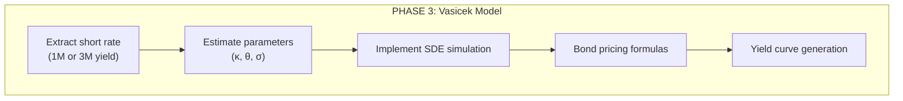

### Code: Vasicek Model Implementation

```python
"""
vasicek_model.py - Vasicek short-rate model implementation.
"""
import numpy as np
from scipy.optimize import minimize
from typing import Tuple
from dataclasses import dataclass


@dataclass
class VasicekParams:
    """Vasicek model parameters."""
    kappa: float  # Mean reversion speed
    theta: float  # Long-term mean
    sigma: float  # Volatility


class VasicekModel:
    """
    Vasicek interest rate model.
    
    dr(t) = κ(θ - r(t))dt + σdW(t)
    
    Features:
    - Parameter estimation via MLE
    - Exact simulation
    - Bond pricing (closed-form)
    - Yield curve generation
    """
    
    def __init__(self, params: VasicekParams = None):
        """
        Initialize Vasicek model.
        
        Args:
            params: Model parameters. If None, must call fit() first.
        """
        self.params = params
    
    def fit(self, short_rates: np.ndarray, dt: float = 1/252) -> VasicekParams:
        """
        Estimate Vasicek parameters using Maximum Likelihood.
        
        Args:
            short_rates: Array of short rate observations (in %).
            dt: Time step between observations (default: 1 day = 1/252 year).
            
        Returns:
            Estimated VasicekParams.
        """
        # Convert to decimal if in percentage
        r = short_rates / 100 if short_rates.mean() > 1 else short_rates
        
        def neg_log_likelihood(params):
            kappa, theta, sigma = params
            if kappa <= 0 or sigma <= 0:
                return 1e10
            
            n = len(r) - 1
            
            # Conditional mean and variance
            e_kdt = np.exp(-kappa * dt)
            mu = r[:-1] * e_kdt + theta * (1 - e_kdt)
            var = (sigma**2 / (2 * kappa)) * (1 - np.exp(-2 * kappa * dt))
            
            # Log-likelihood
            residuals = r[1:] - mu
            ll = -0.5 * n * np.log(2 * np.pi * var) - 0.5 * np.sum(residuals**2 / var)
            
            return -ll  # Minimize negative log-likelihood
        
        # Initial guess: OLS regression
        dr = np.diff(r)
        X = np.column_stack([np.ones(len(r)-1), r[:-1]])
        beta = np.linalg.lstsq(X, dr, rcond=None)[0]
        
        kappa_init = -beta[1] / dt
        theta_init = -beta[0] / (beta[1]) if beta[1] != 0 else r.mean()
        sigma_init = np.std(dr) / np.sqrt(dt)
        
        # Optimize
        result = minimize(
            neg_log_likelihood,
            x0=[max(0.1, kappa_init), theta_init, max(0.001, sigma_init)],
            method='Nelder-Mead',
            options={'maxiter': 10000}
        )
        
        kappa, theta, sigma = result.x
        self.params = VasicekParams(kappa=kappa, theta=theta, sigma=sigma)
        
        return self.params
    
    def simulate(
        self,
        r0: float,
        T: float,
        n_steps: int,
        n_paths: int = 1000,
        seed: int = None
    ) -> Tuple[np.ndarray, np.ndarray]:
        """
        Simulate short rate paths using exact discretization.
        
        Args:
            r0: Initial short rate.
            T: Time horizon (in years).
            n_steps: Number of time steps.
            n_paths: Number of Monte Carlo paths.
            seed: Random seed for reproducibility.
            
        Returns:
            Tuple of (time_grid, rate_paths).
            rate_paths has shape (n_paths, n_steps + 1).
        """
        if self.params is None:
            raise ValueError("Must fit model or provide params first")
        
        if seed is not None:
            np.random.seed(seed)
        
        kappa = self.params.kappa
        theta = self.params.theta
        sigma = self.params.sigma
        
        dt = T / n_steps
        t = np.linspace(0, T, n_steps + 1)
        
        # Pre-compute constants
        e_kdt = np.exp(-kappa * dt)
        std = np.sqrt((sigma**2 / (2 * kappa)) * (1 - np.exp(-2 * kappa * dt)))
        
        # Initialize paths
        r = np.zeros((n_paths, n_steps + 1))
        r[:, 0] = r0
        
        # Generate standard normal random variables
        Z = np.random.standard_normal((n_paths, n_steps))
        
        # Simulate (exact discretization)
        for i in range(n_steps):
            r[:, i+1] = r[:, i] * e_kdt + theta * (1 - e_kdt) + std * Z[:, i]
        
        return t, r
    
    def bond_price(self, r: float, T: float) -> float:
        """
        Compute zero-coupon bond price using closed-form formula.
        
        Args:
            r: Current short rate.
            T: Time to maturity (in years).
            
        Returns:
            Bond price P(0, T).
        """
        if self.params is None:
            raise ValueError("Must fit model or provide params first")
        
        kappa = self.params.kappa
        theta = self.params.theta
        sigma = self.params.sigma
        
        # B(T) function
        B = (1 - np.exp(-kappa * T)) / kappa
        
        # A(T) function
        A = np.exp(
            (theta - sigma**2 / (2 * kappa**2)) * (B - T) -
            (sigma**2 / (4 * kappa)) * B**2
        )
        
        return A * np.exp(-B * r)
    
    def yield_curve(self, r: float, maturities: np.ndarray) -> np.ndarray:
        """
        Generate the yield curve for given maturities.
        
        Args:
            r: Current short rate.
            maturities: Array of maturities in years.
            
        Returns:
            Array of yields (in same units as r).
        """
        yields = np.zeros(len(maturities))
        
        for i, T in enumerate(maturities):
            if T == 0:
                yields[i] = r
            else:
                P = self.bond_price(r, T)
                yields[i] = -np.log(P) / T
        
        return yields
```

---

## Phase 4: HJM Model


### Code: HJM Framework

```python
"""
hjm_model.py - Heath-Jarrow-Morton framework implementation.
"""
import numpy as np
from typing import Callable, List, Tuple
from scipy.integrate import quad
from scipy.interpolate import interp1d


class HJMModel:
    """
    Heath-Jarrow-Morton interest rate model.
    
    Models the evolution of the entire forward rate curve using
    principal component-based volatility functions.
    
    df(t,T) = α(t,T)dt + Σᵢ σᵢ(T-t)dWᵢ(t)
    
    where α is determined by no-arbitrage.
    """
    
    def __init__(
        self,
        volatility_functions: List[Callable],
        maturities: np.ndarray
    ):
        """
        Initialize HJM model.
        
        Args:
            volatility_functions: List of volatility functions σᵢ(τ).
                                  Each takes maturity τ and returns volatility.
            maturities: Array of maturities (in years) for the curve.
        """
        self.vol_funcs = volatility_functions
        self.n_factors = len(volatility_functions)
        self.maturities = maturities
    
    def compute_drift(self, tau: float) -> float:
        """
        Compute HJM drift at maturity τ using no-arbitrage condition.
        
        α(τ) = Σᵢ σᵢ(τ) ∫₀^τ σᵢ(u) du
        
        Args:
            tau: Time to maturity.
            
        Returns:
            Drift value at maturity τ.
        """
        drift = 0.0
        
        for sigma_i in self.vol_funcs:
            # Compute integral ∫₀^τ σᵢ(u) du
            integral, _ = quad(sigma_i, 0, tau)
            drift += sigma_i(tau) * integral
        
        return drift
    
    def simulate(
        self,
        f0: np.ndarray,
        T: float,
        n_steps: int,
        n_paths: int = 1000,
        seed: int = None
    ) -> Tuple[np.ndarray, np.ndarray]:
        """
        Simulate forward rate curve evolution.
        
        Args:
            f0: Initial forward rate curve (array of forwards for each maturity).
            T: Simulation horizon (in years).
            n_steps: Number of time steps.
            n_paths: Number of Monte Carlo paths.
            seed: Random seed.
            
        Returns:
            Tuple of (time_grid, forward_curves).
            forward_curves has shape (n_paths, n_steps + 1, n_maturities).
        """
        if seed is not None:
            np.random.seed(seed)
        
        dt = T / n_steps
        sqrt_dt = np.sqrt(dt)
        n_maturities = len(self.maturities)
        
        # Initialize storage
        forwards = np.zeros((n_paths, n_steps + 1, n_maturities))
        forwards[:, 0, :] = f0
        
        # Time grid
        t = np.linspace(0, T, n_steps + 1)
        
        # Pre-compute volatilities and drifts for each maturity
        vols = np.zeros((n_maturities, self.n_factors))
        drifts = np.zeros(n_maturities)
        
        for j, tau in enumerate(self.maturities):
            drifts[j] = self.compute_drift(tau)
            for i, sigma in enumerate(self.vol_funcs):
                vols[j, i] = sigma(tau)
        
        # Generate random increments
        dW = np.random.standard_normal((n_paths, n_steps, self.n_factors)) * sqrt_dt
        
        # Simulate
        for step in range(n_steps):
            # Current time and remaining maturities
            current_t = t[step]
            
            for j, tau in enumerate(self.maturities):
                # Remaining time to maturity
                tau_remaining = tau - current_t
                
                if tau_remaining <= 0:
                    # Maturity has passed, forward rate becomes spot
                    forwards[:, step + 1, j] = forwards[:, step, j]
                else:
                    # Update volatilities for remaining time
                    drift_j = self.compute_drift(tau_remaining)
                    vol_j = np.array([sigma(tau_remaining) for sigma in self.vol_funcs])
                    
                    # SDE update: df = α dt + Σ σᵢ dWᵢ
                    diffusion = np.sum(vol_j * dW[:, step, :], axis=1)
                    forwards[:, step + 1, j] = (
                        forwards[:, step, j] + 
                        drift_j * dt + 
                        diffusion
                    )
        
        return t, forwards
    
    def forward_to_yield(self, forward_curve: np.ndarray) -> np.ndarray:
        """
        Convert forward rate curve to yield curve.
        
        y(T) = (1/T) ∫₀^T f(0,u) du
        
        Args:
            forward_curve: Array of forward rates.
            
        Returns:
            Array of yields for each maturity.
        """
        yields = np.zeros(len(self.maturities))
        
        # Create interpolation function for forwards
        f_interp = interp1d(
            self.maturities, forward_curve, 
            kind='linear', fill_value='extrapolate'
        )
        
        for j, T in enumerate(self.maturities):
            if T == 0:
                yields[j] = forward_curve[0]
            else:
                # Numerical integration
                integral, _ = quad(f_interp, 0, T)
                yields[j] = integral / T
        
        return yields


def create_volatility_functions_from_pca(
    eigenvalues: np.ndarray,
    eigenvectors: np.ndarray,
    maturities: np.ndarray,
    n_factors: int = 3
) -> List[Callable]:
    """
    Create HJM volatility functions from PCA results.
    
    σᵢ(τ) = √λᵢ × vᵢ(τ)
    
    Args:
        eigenvalues: Array of eigenvalues from PCA.
        eigenvectors: Matrix of eigenvectors (columns).
        maturities: Array of maturities in years.
        n_factors: Number of factors to use.
        
    Returns:
        List of volatility functions.
    """
    vol_funcs = []
    
    for i in range(n_factors):
        # Scale eigenvector by sqrt of eigenvalue
        scaled_loadings = np.sqrt(eigenvalues[i]) * eigenvectors[:, i]
        
        # Create interpolation function
        interp_func = interp1d(
            maturities, scaled_loadings,
            kind='cubic', fill_value='extrapolate'
        )
        
        # Wrap in a closure to capture current i
        def make_vol_func(func):
            return lambda tau: func(tau)
        
        vol_funcs.append(make_vol_func(interp_func))
    
    return vol_funcs
```

---

## Phase 5: Simulation & Results

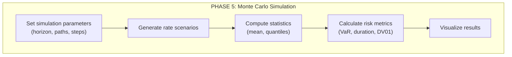

### Code: Main Simulation Script

```python
"""
main_simulation.py - Complete simulation pipeline.
"""
import numpy as np
import pandas as pd
import matplotlib.pyplot as plt
from src.data_loader import YieldCurveLoader
from src.pca_analysis import YieldCurvePCA
from src.vasicek_model import VasicekModel, VasicekParams
from src.hjm_model import HJMModel, create_volatility_functions_from_pca


def main():
    """Execute the complete Vasicek-HJM simulation pipeline."""
    
    # =========================================
    # STEP 1: Load and prepare data
    # =========================================
    print("Loading yield curve data...")
    yields = pd.read_csv('data/processed/yield_curves.csv', index_col=0, parse_dates=True)
    changes = pd.read_csv('data/processed/yield_changes.csv', index_col=0, parse_dates=True)
    
    # =========================================
    # STEP 2: PCA Analysis
    # =========================================
    print("\nPerforming PCA analysis...")
    pca = YieldCurvePCA(n_components=3)
    pca_result = pca.fit(changes)
    print(pca.summary())
    
    # =========================================
    # STEP 3: Vasicek Calibration
    # =========================================
    print("\nCalibrating Vasicek model...")
    short_rate = yields['1M'].values  # Use 1-month rate as short rate
    
    vasicek = VasicekModel()
    params = vasicek.fit(short_rate)
    
    print(f"Vasicek Parameters:")
    print(f"  κ (mean reversion): {params.kappa:.4f}")
    print(f"  θ (long-term mean): {params.theta*100:.2f}%")
    print(f"  σ (volatility):     {params.sigma*100:.2f}%")
    
    # =========================================
    # STEP 4: Simulate Vasicek
    # =========================================
    print("\nSimulating Vasicek short rate paths...")
    r0 = short_rate[-1] / 100  # Current rate (decimal)
    t_vasicek, r_paths = vasicek.simulate(
        r0=r0, T=5, n_steps=252*5, n_paths=10000, seed=42
    )
    
    # =========================================
    # STEP 5: Build HJM Model
    # =========================================
    print("\nBuilding HJM model from PCA...")
    maturity_years = np.array([1/12, 3/12, 6/12, 1, 2, 3, 5, 7, 10, 30])
    
    vol_funcs = create_volatility_functions_from_pca(
        eigenvalues=pca_result.eigenvalues,
        eigenvectors=pca_result.eigenvectors,
        maturities=maturity_years,
        n_factors=3
    )
    
    hjm = HJMModel(volatility_functions=vol_funcs, maturities=maturity_years)
    
    # =========================================
    # STEP 6: Simulate HJM
    # =========================================
    print("Simulating HJM forward curves...")
    f0 = yields.iloc[-1].values / 100  # Current forward curve (decimal)
    
    t_hjm, forward_paths = hjm.simulate(
        f0=f0, T=1, n_steps=252, n_paths=5000, seed=42
    )
    
    # =========================================
    # STEP 7: Compute Statistics
    # =========================================
    print("\nComputing simulation statistics...")
    
    # Vasicek: terminal rate distribution
    r_terminal = r_paths[:, -1] * 100  # Back to percentage
    
    print(f"\n5-Year Vasicek Short Rate Forecast:")
    print(f"  Mean:       {r_terminal.mean():.2f}%")
    print(f"  Std Dev:    {r_terminal.std():.2f}%")
    print(f"  5th %%ile:  {np.percentile(r_terminal, 5):.2f}%")
    print(f"  95th %%ile: {np.percentile(r_terminal, 95):.2f}%")
    
    # HJM: 10-year rate distribution at horizon
    rate_10y_terminal = forward_paths[:, -1, 8] * 100  # Index 8 = 10Y
    
    print(f"\n1-Year HJM 10-Year Rate Forecast:")
    print(f"  Mean:       {rate_10y_terminal.mean():.2f}%")
    print(f"  Std Dev:    {rate_10y_terminal.std():.2f}%")
    print(f"  5th %%ile:  {np.percentile(rate_10y_terminal, 5):.2f}%")
    print(f"  95th %%ile: {np.percentile(rate_10y_terminal, 95):.2f}%")
    
    print("\n" + "=" * 60)
    print("SIMULATION COMPLETE")
    print("=" * 60)


if __name__ == "__main__":
    main()
```

---

# Part 4: Configuration File

```yaml
# config.yaml - Project configuration

# API Keys
fred_api_key: "YOUR_FRED_API_KEY_HERE"

# Data settings
data:
  start_date: "2014-01-01"
  end_date: "2024-01-01"
  maturities:
    - "1M"
    - "3M"
    - "6M"
    - "1Y"
    - "2Y"
    - "3Y"
    - "5Y"
    - "7Y"
    - "10Y"
    - "30Y"

# PCA settings
pca:
  n_components: 3
  standardize: false

# Simulation settings
simulation:
  vasicek:
    horizon_years: 5
    n_steps: 1260  # 5 years * 252 trading days
    n_paths: 10000
  hjm:
    horizon_years: 1
    n_steps: 252
    n_paths: 5000
  seed: 42
```

---

# Part 5: Quick Start Guide

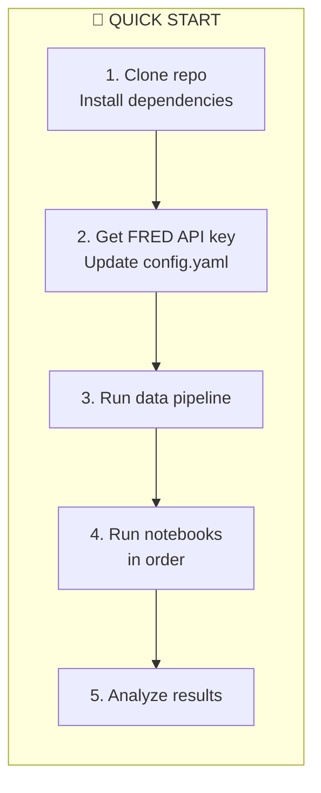

### Terminal Commands

```bash
# 1. Create project structure
mkdir interest-rate-models && cd interest-rate-models
mkdir -p data/{raw,processed,results} src notebooks tests

# 2. Set up virtual environment
python -m venv venv
source venv/bin/activate  # Linux/Mac
# venv\Scripts\activate   # Windows

# 3. Install dependencies
pip install -r requirements.txt

# 4. Run data pipeline
python main_data_pipeline.py

# 5. Launch Jupyter
jupyter notebook notebooks/
```

---

# Parameter Estimation & Visualization Guide

## Conceptual Deep Dive (No Code)

---

# Part 1: Parameter Estimation Techniques

## 1.1 Overview of Calibration Methods

When calibrating interest rate models like Vasicek, we need to estimate the parameters \( \kappa \), \( \theta \), and \( \sigma \) from historical data. There are several approaches, each with trade-offs.

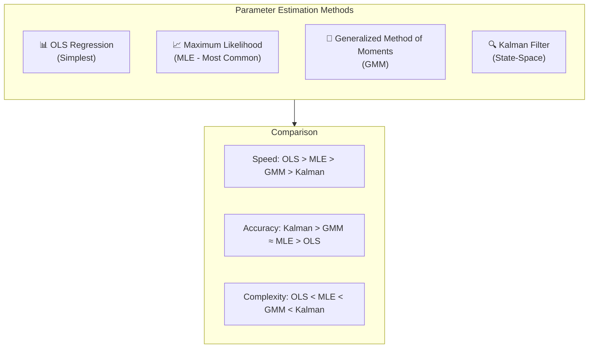

---

## 1.2 Method 1: Ordinary Least Squares (OLS)

### The Idea

The Vasicek model can be discretized as:

\[
r_{t+1} - r_t = a + b \cdot r_t + \epsilon_t
\]

This is a simple linear regression! We regress rate changes on rate levels.

### Parameter Extraction

| Regression Output | Vasicek Parameter |
|-------------------|-------------------|
| Intercept \( a \) | \( \kappa \theta \Delta t \) |
| Slope \( b \) | \( -\kappa \Delta t \) |
| Residual std \( s \) | \( \sigma \sqrt{\Delta t} \) |

### Pros & Cons

| ✅ Pros | ❌ Cons |
|---------|---------|
| Very simple | Ignores autocorrelation |
| Fast computation | Biased for small samples |
| Good initial guess | Assumes constant variance |

### When to Use

Use OLS as a **starting point** to get initial parameter estimates, then refine with MLE.

---

## 1.3 Method 2: Maximum Likelihood Estimation (MLE)

### The Idea

MLE finds parameters that make the observed data **most probable**. For Vasicek, since \( r_{t+1} | r_t \) is normally distributed, we know the exact likelihood function.

### The Likelihood Function

Given the transition density:

\[
r_{t+1} | r_t \sim \mathcal{N}\left( \mu_t, \sigma_t^2 \right)
\]

Where:
- \( \mu_t = r_t e^{-\kappa \Delta t} + \theta(1 - e^{-\kappa \Delta t}) \)
- \( \sigma_t^2 = \frac{\sigma^2}{2\kappa}(1 - e^{-2\kappa \Delta t}) \)

The log-likelihood is:

\[
\mathcal{L}(\kappa, \theta, \sigma) = -\frac{n}{2}\ln(2\pi\sigma_t^2) - \frac{1}{2\sigma_t^2}\sum_{i=1}^{n}(r_{t+1} - \mu_t)^2
\]

### Optimization Process

```mermaid
flowchart LR
    A["Initial Guess<br/>(from OLS)"] --> B["Evaluate<br/>Log-Likelihood"]
    B --> C{"Converged?"}
    C -->|No| D["Update Parameters<br/>(Nelder-Mead or BFGS)"]
    D --> B
    C -->|Yes| E["Final Parameters<br/>+ Standard Errors"]
```

### Pros & Cons

| ✅ Pros | ❌ Cons |
|---------|---------|
| Statistically efficient | Requires optimization |
| Exact for Gaussian models | Can get stuck in local minima |
| Provides standard errors | Sensitive to initial values |

### When to Use

MLE is the **standard choice** for Vasicek calibration. It's statistically optimal and widely accepted.

---

## 1.4 Method 3: Generalized Method of Moments (GMM)

### The Idea

GMM matches **theoretical moments** (from the model) to **sample moments** (from data). You don't need to know the full distribution—just enough moment conditions.

### Moment Conditions for Vasicek

We can derive moment conditions from the model:

| Moment | Theoretical Value | Sample Estimate |
|--------|-------------------|-----------------|
| \( \mathbb{E}[r_t] \) | \( \theta \) | \( \bar{r} \) |
| \( \text{Var}(r_t) \) | \( \frac{\sigma^2}{2\kappa} \) | \( s_r^2 \) |
| \( \text{Cov}(r_t, r_{t-1}) \) | \( \text{Var}(r) \cdot e^{-\kappa \Delta t} \) | sample autocovariance |

### The GMM Objective

Minimize the weighted distance between theoretical and sample moments:

\[
\min_{\kappa, \theta, \sigma} \left( \mathbf{g}_T(\theta) - \mathbf{g}_{model}(\kappa, \theta, \sigma) \right)' \mathbf{W} \left( \mathbf{g}_T - \mathbf{g}_{model} \right)
\]

### Pros & Cons

| ✅ Pros | ❌ Cons |
|---------|---------|
| Robust to distributional misspecification | Less efficient than MLE |
| Flexible choice of moments | Requires selecting weight matrix |
| Can handle more complex models | More moments = more complexity |

### When to Use

Use GMM when you're **uncertain about normality** or want to incorporate additional moment conditions (e.g., higher moments, cross-sectional constraints).

---

## 1.5 Method 4: Kalman Filter

### The Idea

The Kalman Filter treats the short rate as a **latent (hidden) state** that we observe with noise. It's particularly useful when:
- You have measurement error in yields
- You want to estimate time-varying parameters
- You have multiple observed yields from one short rate

### State-Space Representation

**State equation** (how the hidden rate evolves):
\[
r_{t+1} = (1 - \kappa\Delta t)\, r_t + \kappa\theta\Delta t + \sigma\sqrt{\Delta t}\, \eta_t
\]

**Observation equation** (how we observe yields):
\[
y_t^{(i)} = A^{(i)} + B^{(i)} r_t + \epsilon_t^{(i)}
\]

Where \( A^{(i)} \) and \( B^{(i)} \) come from the bond pricing formulas.

### The Kalman Filter Algorithm

```mermaid
flowchart TB
    subgraph PREDICT["PREDICT STEP"]
        P1["Prior state estimate:<br/>r̂ₜ|ₜ₋₁"]
        P2["Prior variance:<br/>Pₜ|ₜ₋₁"]
    end
    
    subgraph UPDATE["UPDATE STEP"]
        U1["Compute Kalman Gain:<br/>Kₜ"]
        U2["Posterior state estimate:<br/>r̂ₜ|ₜ"]
        U3["Posterior variance:<br/>Pₜ|ₜ"]
    end
    
    subgraph LIKELIHOOD["LIKELIHOOD"]
        L1["Prediction error"]
        L2["Log-likelihood contribution"]
    end
    
    PREDICT --> UPDATE --> LIKELIHOOD
    LIKELIHOOD -->|"Next t"| PREDICT
```

### Pros & Cons

| ✅ Pros | ❌ Cons |
|---------|---------|
| Handles measurement noise | More complex to implement |
| Uses full yield curve information | Computationally intensive |
| Optimal for state-space models | Requires careful specification |
| Can filter out noise from data | |

### When to Use

Use the Kalman Filter when you want to **jointly estimate the short rate path and model parameters** from multiple observed yields. It's the most sophisticated approach and commonly used in professional settings.

---

## 1.6 Comparison Summary

```mermaid
flowchart TB
    subgraph CHOICE["Choosing a Method"]
        Q1{"Quick estimate<br/>needed?"}
        Q1 -->|Yes| A1["Use OLS"]
        Q1 -->|No| Q2
        
        Q2{"Single rate<br/>series?"}
        Q2 -->|Yes| A2["Use MLE"]
        Q2 -->|No| Q3
        
        Q3{"Measurement<br/>error?"}
        Q3 -->|Yes| A3["Use Kalman Filter"]
        Q3 -->|No| A4["Use GMM"]
    end
```

| Method | Speed | Accuracy | Complexity | Best For |
|--------|-------|----------|------------|----------|
| **OLS** | ⚡⚡⚡ | ⭐⭐ | ⭐ | Initial estimates |
| **MLE** | ⚡⚡ | ⭐⭐⭐⭐ | ⭐⭐ | Standard calibration |
| **GMM** | ⚡⚡ | ⭐⭐⭐ | ⭐⭐⭐ | Robust estimation |
| **Kalman** | ⚡ | ⭐⭐⭐⭐⭐ | ⭐⭐⭐⭐ | Multi-yield calibration |

---

# Part 2: Visualization Guide

## 2.1 Complete Visualization Roadmap

```mermaid
flowchart TB
    subgraph DATA["📊 DATA EXPLORATION"]
        D1["Yield Curve Time Series"]
        D2["Yield Curve 3D Surface"]
        D3["Correlation Heatmap"]
        D4["Yield Change Distribution"]
    end
    
    subgraph PCA["🎯 PCA RESULTS"]
        P1["Scree Plot<br/>(Variance Explained)"]
        P2["Factor Loadings Plot"]
        P3["Factor Score Time Series"]
        P4["Reconstruction Quality"]
    end
    
    subgraph MODEL["📈 MODEL OUTPUTS"]
        M1["Vasicek: Rate Path Fan Chart"]
        M2["Vasicek: Terminal Distribution"]
        M3["HJM: Yield Curve Evolution"]
        M4["HJM: Rate Distribution by Maturity"]
    end
    
    subgraph RISK["⚠️ RISK METRICS"]
        R1["VaR Histogram"]
        R2["Duration Profile"]
        R3["Scenario Comparison"]
    end
    
    DATA --> PCA --> MODEL --> RISK
```

---

## 2.2 Data Exploration Visualizations

### 2.2.1 Yield Curve Time Series

**Purpose:** Show how individual rates evolve over time.

**What to plot:**
- X-axis: Date
- Y-axis: Yield (%)
- Multiple lines: One per maturity (use color gradient short→long)

**Key insights to highlight:**
- Rate level changes (up/down trends)
- Relative movements (do short and long rates move together?)
- Crisis periods (2008, 2020, etc.)

---

### 2.2.2 Yield Curve 3D Surface

**Purpose:** Visualize the entire yield curve evolution in one view.

**What to plot:**
- X-axis: Date
- Y-axis: Maturity (years)
- Z-axis (color): Yield level

**Key insights:**
- Overall shape evolution
- Periods of inversion (short > long)
- Volatility clusters

---

### 2.2.3 Correlation Heatmap

**Purpose:** Show how correlated different maturities are.

**What to plot:**
- Matrix of correlations between yield changes
- Maturities on both axes
- Color scale: -1 (blue) to +1 (red)

**Key insights:**
- Adjacent maturities highly correlated
- Short and long ends less correlated
- Justifies dimensionality reduction (PCA)

---

### 2.2.4 Yield Change Distribution

**Purpose:** Check normality assumption and identify outliers.

**What to plot:**
- Histogram of daily yield changes
- Overlay: Normal distribution with same mean/std
- Q-Q plot alongside

**Key insights:**
- Fat tails (more extreme moves than normal)
- Skewness (asymmetric moves)
- Justifies robust methods (GMM)

---

## 2.3 PCA Result Visualizations

### 2.3.1 Scree Plot

**Purpose:** Determine how many components to keep.

**What to plot:**
- Bar chart: Individual variance explained per PC
- Line: Cumulative variance explained
- Horizontal line at 95% threshold

**Key insights:**
- First 3 PCs explain 95%+
- Clear "elbow" after PC3
- Remaining PCs are noise

---

### 2.3.2 Factor Loadings Plot

**Purpose:** Interpret what each principal component represents.

**What to plot:**
- X-axis: Maturity (years)
- Y-axis: Loading value
- Three lines: PC1, PC2, PC3

**Expected patterns:**

| PC | Shape | Interpretation |
|----|-------|----------------|
| PC1 | Flat, all positive | Level (parallel shift) |
| PC2 | Monotonic slope | Slope (steepening/flattening) |
| PC3 | Hump/U-shape | Curvature (butterfly) |

---

### 2.3.3 Factor Score Time Series

**Purpose:** See how each factor evolves over time.

**What to plot:**
- X-axis: Date
- Y-axis: Factor score (standardized)
- Three subplots: PC1, PC2, PC3

**Key insights:**
- PC1: Correlates with Fed rate changes
- PC2: Correlates with economic cycle
- PC3: Correlates with specific events

---

### 2.3.4 Reconstruction Quality

**Purpose:** Validate that 3 components capture the dynamics.

**What to plot:**
- Original yield changes vs. reconstructed
- Scatter plot with 45° line
- R² metric displayed

**Key insights:**
- Points should cluster around 45° line
- R² should be > 95%
- Outliers indicate unusual days

---

## 2.4 Model Output Visualizations

### 2.4.1 Vasicek: Rate Path Fan Chart

**Purpose:** Show the range of possible future short rate paths.

**What to plot:**
- X-axis: Time (years into future)
- Y-axis: Short rate (%)
- Shaded regions: Confidence bands (5th-95th percentile)
- Solid line: Median path

**Key insights:**
- Mean reversion: Paths converge toward θ
- Uncertainty grows with time
- Long-term stationary distribution

---

### 2.4.2 Vasicek: Terminal Distribution

**Purpose:** Show the probability distribution of rates at the horizon.

**What to plot:**
- Histogram of terminal rates (from Monte Carlo)
- Overlay: Theoretical normal distribution
- Vertical lines: Mean, 5th/95th percentiles

**Key insights:**
- Distribution should be approximately normal
- Compare to theoretical stationary distribution
- Identify tail risk scenarios

---

### 2.4.3 HJM: Yield Curve Evolution

**Purpose:** Animate or show snapshots of the entire curve moving.

**What to plot:**
- X-axis: Maturity (years)
- Y-axis: Yield (%)
- Multiple curves: Different time points
- Color gradient: From start (light) to end (dark)

**Key insights:**
- Curve shape changes over time
- Level, slope, and curvature movements
- Realistic dynamics from PCA volatilities

---

### 2.4.4 HJM: Rate Distribution by Maturity

**Purpose:** Show uncertainty across the entire curve at the horizon.

**What to plot:**
- X-axis: Maturity (years)
- Y-axis: Yield (%)
- Box plots or violin plots for each maturity
- Median line connecting boxes

**Key insights:**
- Short-end vs. long-end uncertainty
- Shape of uncertainty (parallel or not)
- Extreme scenarios

---

## 2.5 Risk Metric Visualizations

### 2.5.1 VaR Histogram

**Purpose:** Show the loss distribution and Value-at-Risk.

**What to plot:**
- Histogram of portfolio P&L (or yield changes)
- Vertical lines: VaR at 95%, 99%
- Shaded tail: Losses beyond VaR

**Key insights:**
- Tail thickness
- VaR level interpretation
- Expected Shortfall (average of tail)

---

### 2.5.2 Duration Profile

**Purpose:** Show interest rate sensitivity across the curve.

**What to plot:**
- X-axis: Maturity
- Y-axis: Duration (years)
- Compare: Vasicek vs. HJM implied durations

**Key insights:**
- Longer maturity = higher duration
- Model differences in duration calculation
- Risk concentration by maturity

---

### 2.5.3 Scenario Comparison

**Purpose:** Compare specific scenarios (base, stress up, stress down).

**What to plot:**
- Multiple yield curves on same chart
- Labels: "Base Case", "+200bp Shock", "-100bp Shock"
- Table: Key rate changes

**Key insights:**
- Parallel vs. non-parallel shocks
- Impact on portfolio valuation
- Regulatory scenarios (Basel, Solvency II)

---

## 2.6 Visualization Best Practices

### Color Schemes

| Use Case | Recommended Palette |
|----------|---------------------|
| Sequential (maturities) | Viridis, Plasma |
| Diverging (up/down) | RdBu, Coolwarm |
| Categorical (factors) | Set2, Dark2 |
| Confidence bands | Grays with solid median |

### Chart Types Summary

| Data Type | Recommended Chart |
|-----------|-------------------|
| Time series | Line chart |
| Distributions | Histogram + KDE |
| Correlations | Heatmap |
| Uncertainty | Fan chart, Box plot |
| 3D data | Surface plot, Contour |
| Comparisons | Grouped bar, Line overlay |

### Labeling Standards

- Always include: Title, axis labels, units
- Add: Legend (if multiple series)
- Consider: Grid lines (light), data source annotation
- Avoid: Cluttered legends, 3D when 2D works

---

## 2.7 Dashboard Layout Suggestion

```mermaid
flowchart TB
    subgraph DASHBOARD["📊 INTEREST RATE MODEL DASHBOARD"]
        subgraph ROW1["Row 1: Data Overview"]
            R1A["Yield Curve<br/>Current + Historical"]
            R1B["Key Metrics<br/>Level/Slope/Curve"]
        end
        
        subgraph ROW2["Row 2: PCA Analysis"]
            R2A["Scree Plot"]
            R2B["Factor Loadings"]
            R2C["Factor Scores"]
        end
        
        subgraph ROW3["Row 3: Model Outputs"]
            R3A["Vasicek Simulation"]
            R3B["HJM Simulation"]
        end
        
        subgraph ROW4["Row 4: Risk Metrics"]
            R4A["VaR Distribution"]
            R4B["Duration Profile"]
            R4C["Scenario Table"]
        end
    end
```

---

# Autoencoder Extension & Risk Metrics

## Advanced Concepts (No Code)

---

# Part 1: Autoencoder Extension

## 1.1 Why Replace PCA with Autoencoders?

PCA is powerful but has a fundamental limitation: it can only capture **linear** relationships. In reality, yield curve dynamics may have non-linear patterns that PCA misses.

```mermaid
flowchart LR
    subgraph PCA_LIMIT["PCA Limitations"]
        L1["Only linear transformations"]
        L2["Fixed basis functions"]
        L3["Optimal for Gaussian data"]
    end
    
    subgraph AE_ADVANTAGE["Autoencoder Advantages"]
        A1["Non-linear transformations"]
        A2["Learned basis functions"]
        A3["Flexible architecture"]
    end
    
    PCA_LIMIT -->|"Upgrade"| AE_ADVANTAGE
```

### When Autoencoders Excel

| Scenario | PCA | Autoencoder |
|----------|-----|-------------|
| Linear relationships | ✅ Optimal | ✅ Can learn |
| Non-linear relationships | ❌ Misses | ✅ Captures |
| Regime changes | ❌ Struggles | ✅ Adapts |
| Complex interactions | ❌ Limited | ✅ Flexible |
| Small datasets | ✅ Robust | ⚠️ May overfit |

---

## 1.2 What is an Autoencoder?

An autoencoder is a neural network that learns to **compress and reconstruct** data. It consists of two parts:

1. **Encoder**: Compresses high-dimensional input to low-dimensional representation
2. **Decoder**: Reconstructs the original data from the compressed representation

```mermaid
flowchart LR
    subgraph INPUT["Input Layer"]
        I1["y₁ (1M)"]
        I2["y₂ (3M)"]
        I3["y₃ (6M)"]
        I4["..."]
        I5["y₁₀ (30Y)"]
    end
    
    subgraph ENCODER["Encoder"]
        E1["Hidden Layer 1<br/>(64 neurons)"]
        E2["Hidden Layer 2<br/>(32 neurons)"]
    end
    
    subgraph LATENT["Latent Space<br/>(Bottleneck)"]
        L1["z₁"]
        L2["z₂"]
        L3["z₃"]
    end
    
    subgraph DECODER["Decoder"]
        D1["Hidden Layer 3<br/>(32 neurons)"]
        D2["Hidden Layer 4<br/>(64 neurons)"]
    end
    
    subgraph OUTPUT["Output Layer"]
        O1["ŷ₁ (1M)"]
        O2["ŷ₂ (3M)"]
        O3["ŷ₃ (6M)"]
        O4["..."]
        O5["ŷ₁₀ (30Y)"]
    end
    
    INPUT --> ENCODER --> LATENT --> DECODER --> OUTPUT
```

### The Key Insight

The **bottleneck** (latent space) forces the network to learn the most important features. With only 3 latent dimensions, the autoencoder must discover the essential patterns—similar to PCA's principal components, but allowing for non-linear transformations.

---

## 1.3 Types of Autoencoders for Yield Curves

### 1.3.1 Vanilla Autoencoder

**Structure:** Simple feedforward layers with a bottleneck.

**Activation functions:** 
- Hidden layers: ReLU or Tanh
- Output layer: Linear (for regression)

**Loss function:** Mean Squared Error (MSE)

\[
\mathcal{L} = \frac{1}{n}\sum_{i=1}^{n} \| \mathbf{y}_i - \hat{\mathbf{y}}_i \|^2
\]

**Best for:** Standard non-linear dimensionality reduction.

---

### 1.3.2 Variational Autoencoder (VAE)

**Key difference:** The latent space is **probabilistic**, not deterministic.

Instead of encoding to a point \( \mathbf{z} \), we encode to a distribution \( \mathcal{N}(\boldsymbol{\mu}, \boldsymbol{\sigma}^2) \).

```mermaid
flowchart LR
    subgraph VAE["Variational Autoencoder"]
        I["Input<br/>Yield Curve"] --> E["Encoder"]
        E --> MU["μ (mean)"]
        E --> SIGMA["σ (std dev)"]
        MU --> SAMPLE["Sample z"]
        SIGMA --> SAMPLE
        SAMPLE --> D["Decoder"]
        D --> O["Reconstructed<br/>Yield Curve"]
    end
```

**Loss function:** Reconstruction + KL Divergence

\[
\mathcal{L} = \underbrace{\| \mathbf{y} - \hat{\mathbf{y}} \|^2}_{\text{Reconstruction}} + \beta \cdot \underbrace{D_{KL}(q(\mathbf{z}|\mathbf{y}) \| p(\mathbf{z}))}_{\text{Regularization}}
\]

**Best for:** Generative modeling—creating new, realistic yield curve scenarios.

---

### 1.3.3 Denoising Autoencoder

**Key difference:** We add noise to inputs and train the network to recover clean outputs.

**Process:**
1. Add random noise to yield curves
2. Train autoencoder to reconstruct original (clean) curves
3. The network learns robust features that ignore noise

**Best for:** Filtering noisy market data, robust feature extraction.

---

### 1.3.4 Temporal Autoencoder (LSTM-based)

**Key difference:** Uses recurrent layers to capture time dependencies.

```mermaid
flowchart LR
    subgraph TEMPORAL["Temporal Autoencoder"]
        T1["Day t-5"] --> LSTM1["LSTM<br/>Encoder"]
        T2["Day t-4"] --> LSTM1
        T3["Day t-3"] --> LSTM1
        T4["Day t-2"] --> LSTM1
        T5["Day t-1"] --> LSTM1
        T6["Day t"] --> LSTM1
        
        LSTM1 --> Z["Latent<br/>State"]
        
        Z --> LSTM2["LSTM<br/>Decoder"]
        
        LSTM2 --> O1["Reconstructed<br/>Day t-5"]
        LSTM2 --> O2["..."]
        LSTM2 --> O6["Reconstructed<br/>Day t"]
    end
```

**Best for:** Capturing temporal patterns, regime detection.

---

## 1.4 Architecture Design Guidelines

### Recommended Architecture for Yield Curves

| Layer | Neurons | Activation | Notes |
|-------|---------|------------|-------|
| Input | 10 | - | 10 maturities |
| Hidden 1 | 64 | ReLU | Expand capacity |
| Hidden 2 | 32 | ReLU | Compress |
| Latent | 3 | Linear | Bottleneck (like 3 PCs) |
| Hidden 3 | 32 | ReLU | Mirror encoder |
| Hidden 4 | 64 | ReLU | Mirror encoder |
| Output | 10 | Linear | Reconstruction |

### Hyperparameter Choices

| Hyperparameter | Typical Value | Rationale |
|----------------|---------------|-----------|
| Latent dimension | 3 | Match PCA (Level, Slope, Curvature) |
| Hidden layers | 2-3 per side | Enough capacity, avoid overfitting |
| Learning rate | 0.001 | Standard for Adam optimizer |
| Batch size | 32-64 | Balance speed and stability |
| Epochs | 100-500 | Until validation loss plateaus |
| Regularization | L2 (0.01) or Dropout (0.1) | Prevent overfitting |

---

## 1.5 Training Process

```mermaid
flowchart TB
    subgraph TRAINING["Autoencoder Training Pipeline"]
        S1["Split data:<br/>Train (70%) / Val (15%) / Test (15%)"]
        S2["Normalize inputs:<br/>Z-score or Min-Max"]
        S3["Initialize network:<br/>Random weights"]
        S4["Forward pass:<br/>Encode → Latent → Decode"]
        S5["Compute loss:<br/>MSE(input, output)"]
        S6["Backward pass:<br/>Gradient descent"]
        S7{"Early stopping?<br/>Val loss not improving?"}
        S8["Save best model"]
        S9["Evaluate on test set"]
        
        S1 --> S2 --> S3 --> S4 --> S5 --> S6 --> S7
        S7 -->|No| S4
        S7 -->|Yes| S8 --> S9
    end
```

### Key Training Considerations

1. **Data normalization:** Essential—neural networks are sensitive to input scales
2. **Validation monitoring:** Watch for overfitting (train loss ↓, val loss ↑)
3. **Early stopping:** Stop when validation loss stops improving (patience: 10-20 epochs)
4. **Weight initialization:** Xavier or He initialization for stable training

---

## 1.6 Interpreting Autoencoder Latent Space

### The Challenge

Unlike PCA, autoencoder latent dimensions don't have guaranteed interpretations. However, we can analyze them.

### Interpretation Techniques

| Technique | Description |
|-----------|-------------|
| **Sensitivity analysis** | Vary one latent dimension, observe output changes |
| **Correlation with PCA** | Compute correlation between AE latent and PCA factors |
| **Factor loading equivalent** | Use Jacobian of decoder to get "loadings" |
| **Visualization** | 2D/3D scatter plots of latent space colored by curve features |

### Expected Findings

If the autoencoder is well-trained with 3 latent dimensions:
- **z₁** will correlate with PC1 (Level)
- **z₂** will correlate with PC2 (Slope)
- **z₃** will correlate with PC3 (Curvature)

But the autoencoder may also capture **non-linear interactions** that PCA misses.

---

## 1.7 Connecting Autoencoder to HJM

### From Autoencoder to Volatility Functions

Just like with PCA, we can extract volatility functions from the autoencoder:

1. **Compute Jacobian of decoder:** \( J = \frac{\partial \hat{\mathbf{y}}}{\partial \mathbf{z}} \)
2. **Each column of J** represents how output yields respond to latent dimension
3. **Use as volatility loading** in the HJM framework

### The HJM Connection

\[
\sigma_i(\tau) = J_{:,i}(\tau) \cdot \sqrt{\text{Var}(z_i)}
\]

Where \( J_{:,i}(\tau) \) is the Jacobian column for latent dimension \( i \) at maturity \( \tau \).

---

## 1.8 PCA vs. Autoencoder Comparison

```mermaid
flowchart TB
    subgraph COMPARISON["Head-to-Head Comparison"]
        subgraph PCA_COL["PCA"]
            P1["✅ Interpretable factors"]
            P2["✅ No hyperparameters"]
            P3["✅ Deterministic result"]
            P4["✅ Works with small data"]
            P5["❌ Linear only"]
            P6["❌ Fixed transformation"]
        end
        
        subgraph AE_COL["Autoencoder"]
            A1["⚠️ Requires interpretation work"]
            A2["⚠️ Many hyperparameters"]
            A3["⚠️ Training variability"]
            A4["⚠️ Needs more data"]
            A5["✅ Non-linear"]
            A6["✅ Learned transformation"]
        end
    end
```

### Recommendation

| Situation | Use |
|-----------|-----|
| Standard project, limited data | **PCA** |
| Research, lots of data | **Autoencoder** |
| Production system | **PCA** (or validated AE) |
| Regime detection | **Autoencoder** |
| First pass analysis | **PCA**, then AE |

---

# Part 2: Risk Metrics Calculations

## 2.1 Overview of Key Risk Metrics

Interest rate risk is measured using several complementary metrics. These quantify how bond/portfolio values change when rates move.

```mermaid
flowchart TB
    subgraph METRICS["Interest Rate Risk Metrics"]
        subgraph SENSITIVITY["Sensitivity Measures"]
            S1["Duration<br/>(1st derivative)"]
            S2["Convexity<br/>(2nd derivative)"]
            S3["DV01 / PV01<br/>(Dollar sensitivity)"]
            S4["Key Rate Duration<br/>(Per maturity)"]
        end
        
        subgraph STATISTICAL["Statistical Measures"]
            ST1["Value at Risk<br/>(VaR)"]
            ST2["Expected Shortfall<br/>(CVaR)"]
            ST3["Stress Testing"]
        end
        
        subgraph REGULATORY["Regulatory Metrics"]
            R1["Interest Rate Risk<br/>in Banking Book (IRRBB)"]
            R2["SCR (Solvency II)"]
        end
    end
```

---

## 2.2 Duration

### Definition

Duration measures the **sensitivity of bond price to yield changes**. It answers: "If yields change by 1%, how much does the bond price change?"

### Types of Duration

| Type | Formula | Interpretation |
|------|---------|----------------|
| **Macaulay Duration** | Weighted average time of cash flows | Time measure (years) |
| **Modified Duration** | Macaulay / (1 + y) | Price sensitivity (% per 1% yield change) |
| **Effective Duration** | (P₋ - P₊) / (2 × P₀ × Δy) | Numerical approximation |

### Macaulay Duration Formula

\[
D_{Mac} = \frac{\sum_{t=1}^{T} t \cdot CF_t \cdot e^{-y \cdot t}}{P}
\]

Where:
- \( CF_t \) = Cash flow at time \( t \)
- \( y \) = Yield to maturity
- \( P \) = Bond price

### Modified Duration

\[
D_{Mod} = \frac{D_{Mac}}{1 + y/m}
\]

Where \( m \) = compounding frequency (e.g., 2 for semi-annual)

### Interpretation

| Duration | Meaning |
|----------|---------|
| 5 years | 1% yield increase → ~5% price decrease |
| 10 years | 1% yield increase → ~10% price decrease |

---

## 2.3 Convexity

### Why Convexity Matters

Duration assumes a **linear** relationship between price and yield. In reality, the relationship is **curved** (convex). Convexity captures this curvature.

```mermaid
flowchart LR
    subgraph CONVEXITY["Price-Yield Relationship"]
        A["Actual Price<br/>(curved)"]
        B["Duration Approximation<br/>(linear)"]
        C["Error at large Δy"]
    end
```

### Formula

\[
C = \frac{1}{P} \cdot \frac{\partial^2 P}{\partial y^2} = \frac{\sum_{t=1}^{T} t^2 \cdot CF_t \cdot e^{-y \cdot t}}{P}
\]

### Price Change Approximation (with Convexity)

\[
\frac{\Delta P}{P} \approx -D_{Mod} \cdot \Delta y + \frac{1}{2} \cdot C \cdot (\Delta y)^2
\]

### Key Insight

- Convexity is always **positive** for standard bonds
- Bonds with higher convexity benefit more from yield volatility
- Convexity adds value when yields move significantly

---

## 2.4 DV01 (Dollar Value of 01)

### Definition

DV01 measures the **dollar change in value** for a **1 basis point** (0.01%) change in yield.

Also called:
- **PV01** (Present Value of 01)
- **BPV** (Basis Point Value)

### Formula

\[
DV01 = -\frac{\partial P}{\partial y} \cdot 0.0001 = P \cdot D_{Mod} \cdot 0.0001
\]

### Example

| Bond Value | Modified Duration | DV01 |
|------------|-------------------|------|
| \$1,000,000 | 5 years | \$500 |
| \$1,000,000 | 10 years | \$1,000 |

**Interpretation:** For a \$1M bond with 5-year duration, a 1bp yield increase causes a \$500 loss.

### Portfolio DV01

For a portfolio, DV01 is additive:

\[
DV01_{portfolio} = \sum_{i} DV01_i
\]

---

## 2.5 Key Rate Duration (KRD)

### Why Key Rate Duration?

Standard duration assumes **parallel shifts**—all rates move equally. In reality, the curve can twist and reshape. KRD captures sensitivity to **specific points** on the curve.

### Definition

Key Rate Duration measures price sensitivity to a **1% change in a specific maturity**, while other rates remain unchanged.

### Standard Key Rates

| Key Rate | Typical Maturities |
|----------|-------------------|
| Short end | 3M, 6M, 1Y |
| Belly | 2Y, 3Y, 5Y |
| Long end | 7Y, 10Y, 30Y |

### Calculation Method

1. Bump the 5Y rate by 1bp (others unchanged)
2. Reprice the bond/portfolio
3. Compute sensitivity: KRD₅ᵧ = (P₋ - P₊) / (2 × P₀ × 0.0001)
4. Repeat for each key rate

### Interpretation

| KRD Profile | Meaning |
|-------------|---------|
| Concentrated at 10Y | Exposed to long-end moves |
| Spread across curve | Diversified rate exposure |
| Negative at some points | Hedge or inverse exposure |

---

## 2.6 Value at Risk (VaR)

### Definition

VaR answers: "What is the **maximum loss** I can expect over a given time horizon, at a given confidence level?"

### The VaR Statement

"The 1-day 95% VaR is \$1 million" means:
- Over the next day
- With 95% confidence
- Losses will not exceed \$1 million
- (But 5% of the time, losses could be worse!)

### VaR Calculation Methods

```mermaid
flowchart TB
    subgraph VAR_METHODS["VaR Calculation Methods"]
        M1["Historical Simulation<br/>(Non-parametric)"]
        M2["Parametric VaR<br/>(Normal assumption)"]
        M3["Monte Carlo Simulation<br/>(Model-based)"]
    end
    
    M1 --> R1["Use actual historical returns"]
    M2 --> R2["VaR = μ - z_α × σ"]
    M3 --> R3["Simulate many scenarios"]
```

### Method 1: Historical Simulation

**Process:**
1. Collect historical yield changes (e.g., 500 days)
2. Apply each historical change to current portfolio
3. Compute P&L for each scenario
4. VaR = 5th percentile of P&L distribution (for 95% VaR)

**Pros:** No distributional assumptions, captures fat tails
**Cons:** Limited by historical data, assumes past = future

### Method 2: Parametric (Variance-Covariance)

**Formula:**

\[
VaR_{1-\alpha} = \mu - z_\alpha \cdot \sigma
\]

Where:
- \( \mu \) = Expected return (often assumed 0)
- \( z_\alpha \) = Normal quantile (e.g., 1.645 for 95%, 2.33 for 99%)
- \( \sigma \) = Portfolio standard deviation

**For interest rate portfolios:**

\[
VaR = |DV01| \times \sigma_{yield} \times z_\alpha \times \sqrt{T}
\]

**Pros:** Fast, analytical
**Cons:** Assumes normality (underestimates tail risk)

### Method 3: Monte Carlo Simulation

**Process:**
1. Calibrate yield curve model (Vasicek or HJM)
2. Simulate thousands of yield curve scenarios
3. Reprice portfolio under each scenario
4. VaR = percentile of simulated P&L

**Pros:** Handles complex portfolios, non-linear instruments
**Cons:** Computationally intensive, model-dependent

---

## 2.7 Expected Shortfall (CVaR)

### The Problem with VaR

VaR tells you the threshold, but not **how bad it gets** beyond that threshold.

### Definition

Expected Shortfall (ES), also called Conditional VaR (CVaR), is the **average loss** in the worst cases beyond VaR.

\[
ES_\alpha = \mathbb{E}[Loss \, | \, Loss > VaR_\alpha]
\]

### Interpretation

| Metric | 95% Level | 99% Level |
|--------|-----------|-----------|
| VaR | Maximum loss in 95% of cases | Maximum loss in 99% of cases |
| ES | Average loss in worst 5% of cases | Average loss in worst 1% of cases |

### Why ES is Preferred

| VaR | ES |
|-----|---|
| ❌ Not coherent (can violate subadditivity) | ✅ Coherent risk measure |
| ❌ Ignores tail severity | ✅ Considers tail losses |
| ❌ Not convex | ✅ Convex (better for optimization) |

**Regulatory trend:** Basel III/IV and Solvency II increasingly require ES over VaR.

---

## 2.8 Stress Testing

### Purpose

Stress testing evaluates portfolio performance under **extreme but plausible** scenarios that may not appear in historical data.

### Types of Stress Tests

```mermaid
flowchart TB
    subgraph STRESS["Stress Testing Types"]
        H["Historical Scenarios<br/>(2008 crisis, 2020 COVID)"]
        P["Hypothetical Scenarios<br/>(+300bp shock, curve inversion)"]
        R["Regulatory Scenarios<br/>(Basel, Solvency II standard)"]
    end
```

### Standard Interest Rate Stress Scenarios

| Scenario | Description | Short Rate | Long Rate |
|----------|-------------|------------|-----------|
| Parallel Up | All rates increase | +200bp | +200bp |
| Parallel Down | All rates decrease | -200bp | -200bp |
| Steepening | Short down, long up | -100bp | +100bp |
| Flattening | Short up, long down | +100bp | -100bp |
| Short Up | Only short end rises | +200bp | 0bp |
| Short Down | Only short end falls | -200bp | 0bp |

### Solvency II Standard Scenarios

European insurers must calculate the **Solvency Capital Requirement (SCR)** for interest rate risk using prescribed shocks:

| Maturity | Up Shock | Down Shock |
|----------|----------|------------|
| 1 year | +70% | -75% |
| 5 years | +55% | -65% |
| 10 years | +42% | -57% |
| 20 years | +26% | -41% |

*Note: Shocks are relative to current rates, with floors at 0% (or negative in some jurisdictions).*

---

## 2.9 Interest Rate Risk in Banking Book (IRRBB)

### Regulatory Context

Basel Committee requires banks to measure and manage interest rate risk for non-trading positions.

### Key IRRBB Metrics

| Metric | Measures | Horizon |
|--------|----------|---------|
| **EVE (Economic Value of Equity)** | Change in net present value of assets minus liabilities | Long-term |
| **NII (Net Interest Income)** | Change in interest income minus expense | 1-2 years |

### EVE Calculation

\[
\Delta EVE = \Delta PV(Assets) - \Delta PV(Liabilities)
\]

Under standardized scenarios (±200bp parallel, steepening, flattening, etc.)

### Connection to Your Model

Your Vasicek-HJM model can be used for IRRBB by:
1. Simulating yield curve scenarios
2. Repricing banking book instruments
3. Aggregating to EVE and NII impacts

---

## 2.10 Putting It All Together

### Risk Dashboard Metrics

```mermaid
flowchart TB
    subgraph DASHBOARD["Risk Metrics Dashboard"]
        subgraph SENSITIVITY["Position Sensitivity"]
            S1["Total Duration: 7.2 years"]
            S2["Total DV01: $1.5M"]
            S3["Convexity: 85"]
        end
        
        subgraph KRD_PROFILE["Key Rate Profile"]
            K1["2Y: 0.5"]
            K2["5Y: 2.1"]
            K3["10Y: 3.8"]
            K4["30Y: 0.8"]
        end
        
        subgraph STAT_RISK["Statistical Risk"]
            R1["95% VaR (1-day): $2.3M"]
            R2["99% VaR (1-day): $4.1M"]
            R3["95% ES (1-day): $3.5M"]
        end
        
        subgraph STRESS["Stress Tests"]
            ST1["Parallel +200bp: -$10.8M"]
            ST2["Parallel -200bp: +$9.2M"]
            ST3["Steepening: -$3.4M"]
        end
    end
```

### Workflow: From Model to Risk Metrics

```mermaid
flowchart LR
    subgraph MODEL["Interest Rate Model"]
        M1["Vasicek/HJM<br/>Calibrated"]
    end
    
    subgraph SCENARIOS["Scenario Generation"]
        S1["Monte Carlo<br/>10,000 paths"]
        S2["Historical<br/>500 days"]
        S3["Stress<br/>6 scenarios"]
    end
    
    subgraph PORTFOLIO["Portfolio Valuation"]
        P1["Reprice bonds"]
        P2["Mark to model"]
        P3["P&L distribution"]
    end
    
    subgraph METRICS["Risk Metrics"]
        R1["VaR/ES"]
        R2["Duration/DV01"]
        R3["Stress results"]
    end
    
    MODEL --> SCENARIOS --> PORTFOLIO --> METRICS
```

---

## 2.11 Summary: Key Formulas Reference

| Metric | Formula | Units |
|--------|---------|-------|
| **Macaulay Duration** | \( \sum t \cdot w_t \) where \( w_t = \frac{CF_t \cdot e^{-yt}}{P} \) | Years |
| **Modified Duration** | \( \frac{D_{Mac}}{1+y} \) | % per 1% yield |
| **DV01** | \( P \times D_{Mod} \times 0.0001 \) | $ per 1bp |
| **Convexity** | \( \frac{1}{P} \sum t^2 \cdot w_t \) | Years² |
| **Parametric VaR** | \( \|DV01\| \times \sigma_y \times z_\alpha \times \sqrt{T} \) | $ |
| **ES (discrete)** | \( \frac{1}{n_{tail}} \sum_{i: L_i > VaR} L_i \) | $ |

---

## 🎓 Project Completion Summary

You now have a complete conceptual framework for:

| Phase | Topic | Status |
|-------|-------|--------|
| 1 | High-Level Overview | ✅ |
| 2 | Mathematical Formulation (Vasicek & HJM) | ✅ |
| 3 | PCA Deep Dive | ✅ |
| 4 | Implementation Roadmap & Data Sources | ✅ |
| 5 | Parameter Estimation | ✅ |
| 6 | Visualization Guide | ✅ |
| 7 | Autoencoder Extension | ✅ |
| 8 | Risk Metrics (VaR, Duration, etc.) | ✅ |

---
